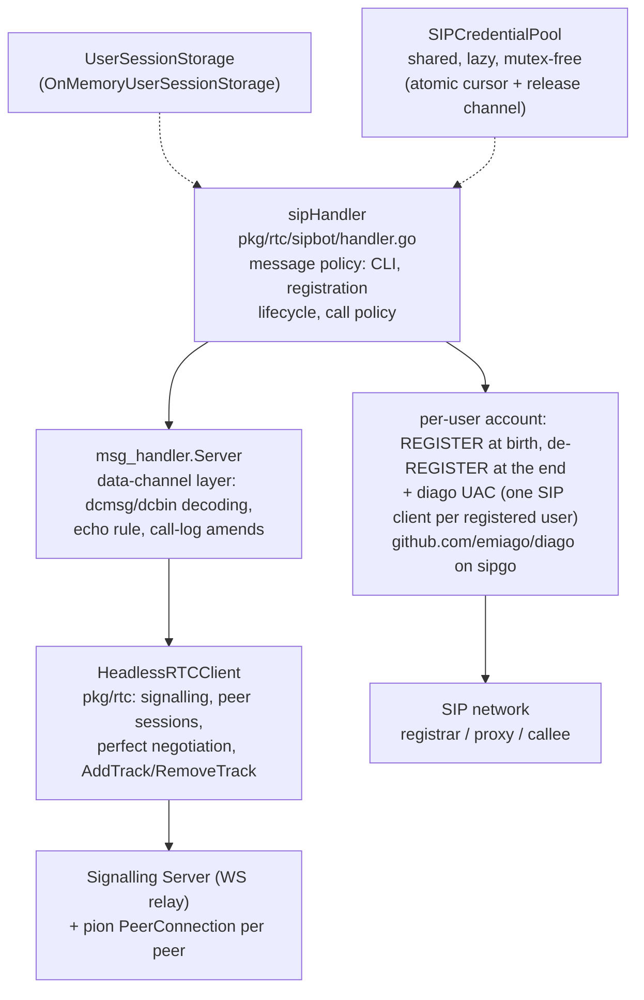

# SIP Bot — Design

Status: **design** (pre-implementation). The doc is the plan of record for
`pkg/rtc/sipbot`; deviations discovered during implementation are to be
folded back into it.

## 1. Purpose

The sip bot is a **session border controller (SBC)** between two voice
networks that share nothing but this host:

- the site's **WebRTC voice network** — the chat subsystem's phone
  sessions, where a call is an in-band SIP-subset dialog over the pair's
  `dcmsg` data channel plus an audio m-line on the pair's long-lived P2P
  peer connection (see `docs/signalling-server.md`, `docs/music-bot.md`);
- an external **SIP voice network** — any RFC 3261 registrar/Proxy the
  bot can reach over UDP (an Asterisk/FreeSWITCH/Kamailio, a residential
  VoIP provider, …).

In SIP terms the bot is a **B2BUA (back-to-back user agent)** for
**signalling** — it terminates both signalling planes and relays each
into the other — but a **media relay** for the media plane, in the
spirit of FreeSWITCH's proxy-media mode (neither full B2BUA media
handling nor bypass-media): the codec is negotiated **end to end**
between the browser and the SIP UA, and the bot's own codec preferences
never participate — the topology is UA(WebRTC) — bot — UA(SIP), and only
the two UAs' media support matters. Media crosses at the RTP payload
level: the bot decrypts and re-encrypts (DTLS-SRTP is mandatory on the
webrtc leg; the sip leg speaks plain RTP), re-originating the transport,
crypto, PTs, SSRCs, and timestamps per leg — but never re-encodes: there
is no transcoding anywhere, so the payload crosses byte for byte. Toward
the SIP network the bot is a UAC (REGISTER + INVITE)
and a UAS (inbound INVITEs to a registered AOR); toward the browser it
is a headless bot peer (the third policy bot on the three-layer bot
stack). The user in the browser can thus phone an arbitrary SIP
subscriber — and a SIP subscriber who dials the user's registered AOR
rings the user's browser (§7.2):

```
browser ──(WebRTC: DTLS-SRTP)──▶ SIP BOT ──(SIP/RTP)──▶ PBX ──▶ callee
       ◀──                      ◀──(SIP INVITE to a registered AOR)──── caller
dcmsg SIP-subset dialog          real SIP: REGISTER, INVITE (both
+ renegotiated m-line            directions), BYE; plain RTP media
        └──── one codec, negotiated end to end by the two UAs (§8) ────┘
```

Like the music bot and the echo bot, the bot is hosted by the server
binary as an ordinary authenticated signalling client
(`cmd/server/main.go`'s `startBotClient`), and like the music bot its
chat is a telegram-style CLI.

## 2. Position in the stack



- **webrtc-leg**: layers 1–3, identical to the music bot's. The audio
  codec toward the browser is **the one codec the call negotiated end to
  end** (§8) — opus, G.722, PCMU, or PCMA — carried on a
  `TrackLocalStaticSample` created with that codec's capability and
  attached to the pair's existing peer connection; the in-band dialog
  verbs (`INVITE`/`200 OK`/`CANCEL`/`BYE`) ride `dcmsg`. No new
  connection is ever created — "a call" is the pair's connection gaining
  an m-line, plus a SIP dialog on the other leg.
- **sip-leg**: one `diago.Diago` transaction user **per registered chat
  user** — each `/register` opens a dedicated SIP client (its own sipgo
  UA, named for the user's SIP username, and its own UDP socket) that
  lives as long as the account. The registration (a REGISTER at the
  account's birth, held untouched, a de-REGISTER at its end — §6) and
  every outbound call (a `diago.Invite` →
  `DialogClientSession`) run on the account's own client, so the wire
  identity is that user's alone: the `From` is the AOR, the `Contact`'s
  user part is the username, the digest credential is the user's — the
  bot's own identity never appears, and no user's credential ever rides
  another user's transport. The same client is the UAS for inbound
  calls: an INVITE arriving on the account's socket is routed to the
  account's owner and rings their browser (§7.2). The codec toward the
  SIP network is **the end-to-end negotiated one** (§8): the outbound
  INVITE's offer carries the _presumed WebRTC codec list_ (the
  configurable `webrtcCodecs`, defaulting to opus, G.722, PCMU, PCMA —
  plus telephone-event, §8) and the answer's selection pins the whole
  call; the inbound call's 200 OK answers with the single selected codec
  directly. When the selection is opus, its fmtp announces
  `useinbandfec=1;stereo=1` (in-band FEC and the RFC 7587 stereo receive
  preference) on both emission points — the webrtc leg's stereo
  negotiation mirrored onto the SIP side; a stereo-capable peer's
  packets then cross the relay untouched, and a mono peer is unaffected
  (the parameter is a preference, never a requirement).

The two legs meet only inside the bot: signalling state is relayed by the
handler (§7), media by a per-call **relay** (§8) — a pair of payload
passthroughs, one per direction.

## 3. The CLI

Chat lines, exactly like the music bot's commands:

| Command                              | Effect                                                                                                                                                                                                                                                                                                                                                                                                                     |
| ------------------------------------ | -------------------------------------------------------------------------------------------------------------------------------------------------------------------------------------------------------------------------------------------------------------------------------------------------------------------------------------------------------------------------------------------------------------------------- |
| `/help`                              | print the help text — what the bot is and does, then the command list                                                                                                                                                                                                                                                                                                                                                      |
| `/register <user@host> <password>`   | associate the chat user with the SIP credential, REGISTER the AOR `sip:user@host` against its host, and keep the registration alive (§6). A later `/register` re-registers (replaces the credential).                                                                                                                                                                                                                      |
| `/unregister`                        | cancel the registration (a SIP de-REGISTER goes out), drop the stored credential, and end any call in progress                                                                                                                                                                                                                                                                                                             |
| `/my-number`                         | print the user's currently registered SIP address — the number others can dial to ring this chat (§7.2) — or answer that the user is not registered to a SIP registrar yet. Reads the LIVE registration: a stored credential whose registration has not run yet is not callable and reads as not-registered. A number loaned from the credential pool is marked as such.                                                   |
| `/call <user@host>` (or bare `user`) | phone the callee through the SIP network and the user through the browser; one active call per chat user. A bare `user` is completed with the registered account's domain. Without a registration the bot falls back to the credential pool when one is configured and has one free (§5 — usually the session-start loan already stands), and says so; when the pool is empty (or absent), the answer points at /register. |
| `/yellow-page`                       | print the yellow page — the phone book of example callable numbers from the configuration (the <sipBot/> element's <yellowPage/> child, §10), grouped by section: who to call, without memorizing numbers                                                                                                                                                                                                                  |
| `/test-call`                         | phone the configured test callee (the `<sipBot/>` element's `testSIPContact`, e.g. `9664@192.168.1.2`) — a known-good subscriber of the SIP network the deployment tests against; answers unavailable when unconfigured                                                                                                                                                                                                    |
| `/hangup`                            | end the current call from chat (equivalent to the browser's hangup button)                                                                                                                                                                                                                                                                                                                                                 |

Every command answers with a chat reply (`Reply`), threaded on the
command. Unknown commands and attachments are answered like the music
bot's (`Unrecognized command — try /help.`, an attachment refusal).
Incoming **browser** calls (a chat user phoning the bot directly, voice
and video alike) are declined with 603: a browser-originated call to
the bot has no routing target (see §11). The reverse direction — a SIP
subscriber phoning the user's registered AOR — is accepted and rings
the browser (§7.2).

Prompt-deficiency note: the request's "`/registered` command" is read as
the `/register` command defined alongside it; there is no separate
`/registered` command.

## 4. Session storage

The bot constructor takes an external, in-memory user session storage —
a small service-like key/value interface. It exists so the credential
store is the caller's affair (the shipped wiring uses the on-memory
implementation; a persistent or shared implementation can be injected
without touching the bot).

```go
// UserSession is one chat user's SIP identity as the bot keeps it:
// the credential /register captured, or a loan from the credential
// pool (§5). It is deliberately plain data —
// the registration's runtime (its cancel func, its diago handles) is
// the handler's, not the store's, so an implementation can serialize
// sessions freely.
type UserSession struct {
    // AddressOfRecord is the SIP AOR as given: "2001@sip.example.com".
    AddressOfRecord string
    // Username is the digest-auth username (the AOR's user part).
    Username string
    // Host is the registrar (the AOR's host part, without a port);
    // Port is its port, zero for the default. (sip.Uri keeps the two
    // separate; stuffing "host:port" into one string mis-builds URIs.)
    Host     string
    Port     int
    Password string
    // Pooled is true when the credential is a loan from the bot's
    // credential pool: the loan returns to the pool when the session
    // leaves the store (/unregister, a replacing /register, the peer
    // session's end).
    Pooled bool
}

// UserSessionStorage is the bot's user-session store: a key/value
// service keyed by the chat subscriber id. Implementations must be
// safe for concurrent use.
type UserSessionStorage interface {
    // Load returns the session stored for user, ok=false when none is.
    Load(user ss.SubscriberId) (UserSession, bool)
    // Store associates user with session, replacing any previous one.
    Store(user ss.SubscriberId, session UserSession)
    // Delete drops user's session; ok is false when none was stored.
    Delete(user ss.SubscriberId) (session UserSession, ok bool)
}

// OnMemoryUserSessionStorage is the shipped implementation: a plain
// map under a RWMutex, living and dying with the process.
type OnMemoryUserSessionStorage struct { /* mu + map */ }

func NewOnMemoryUserSessionStorage() *OnMemoryUserSessionStorage
```

Constructor (mirroring `musicbot.New`'s shape, with the store as its own
parameter per the requirement):

```go
func New(client *rtc.HeadlessRTCClient, storage UserSessionStorage, pool *SIPCredentialPool, config Configuration)
```

`Configuration` carries the logger and the SIP-side knobs (§10); the
pool is §5's credential pool, shared by every chat user (nil: no pool —
the allocate path then always fails into the `/register` hint).

## 5. The credential pool

`/register` is the user bringing their own SIP account. A deployment
can also **lend** its own: the `<sipBot/>` element carries an optional
`<sipCredentialPool/>`, the bot's pool of SIP accounts for chat users
who bring none — zero or more `<sipCredential/>` entries, then zero or
more `<sipCredentialRange/>` entries:

```xml
<sipCredentialPool>
  <sipCredential sipUri="sip:1001@sip.example.com" password="1234" />
  <sipCredentialRange usernameRange="1101-1120" password="hell0" sipServer="sip.example.com" />
</sipCredentialPool>
```

A `<sipCredential/>` is one account: the full SIP URI and its password.
A `<sipCredentialRange/>` is a span of accounts sharing one password
and one server: `usernameRange` is a range expression,
`<integer>-<integer>`, both ends inclusive (`"1101-1120"` is the twenty
accounts 1101…1120; the integer is the username, so leading zeros are
not preserved), and `sipServer` is the registrar as `host[:port]` (the
schema marks it optional so a range can be sketched without it; the
wiring rejects an empty one at startup, like any invalid entry). IPv6
literals are written bracketed, as in a SIP URI: `sipServer="[2a0a:4cc0::1]:5060"`
— the same form holds for a `<sipCredential/>`'s `sipUri`, the
`testSIPContact`, and the CLI's addresses.

The pool is **lazy**: a range is kept as its descriptor (from, to,
password, server) and a username is materialized into a `UserSession`
only when the allocation cursor passes its index — a 10 000-account
range costs two integers at startup, not 10 000 structs. (A span cap —
100 000 per range — keeps a typo'd endpoint from sizing the release
channel absurdly.)

The pool is **stateful** — it tracks which accounts are on loan — and
**shared**: one `*SIPCredentialPool` is injected into the bot
constructor and every chat user draws from it. It is concurrency-safe
**without a mutex**: the fresh-credential cursor is an `atomic.Uint64`
over the descriptor space (explicit entries first, then the ranges in
document order), and returned loans ride a buffered channel whose
capacity is the pool's size. The method set is the minimum a pool
needs:

```go
// Allocate loans a free credential; ok is false when the pool is
// empty or exhausted (a nil pool is a valid empty pool). Fresh
// credentials come first; released loans are re-used only once the
// fresh run out, so an account that just failed a registration sinks
// to the back of the queue instead of failing the very next user too.
Allocate() (UserSession, bool)
// Release returns a loaned credential. Releasing one that is not on
// loan hands it out twice — SIP tolerates concurrent registrations of
// one account, and the bot releases each loan exactly once by
// construction.
Release(credential UserSession)
```

The loaned value is a full `UserSession` with `Pooled: true`; it lives
in the store like a `/register`ed credential, the flag marking the loan
for the release points.

**When the bot allocates**: at the peer session's start (the §9
lifecycle hook), not on the first `/call` — the loan and its REGISTER
happen up front, off the hub (the REGISTER's round trip rides its own
goroutine, serialized with the commands' account lifecycle by the
handler's account mutex), and the user is told their number right away,
unthreaded, over the unsolicited-send path: `Registered as
sip:1101@sip.example.com (an account from the bot's pool).` The first
`/call` then finds the loan standing — no REGISTER round trip in the
call path — and the number is callable (inbound, §7.2) for the
session's whole life. The loan is **best-effort**: an empty pool or a
failed registration is silent at session start; `/call`'s on-demand
path (below) remains as the fallback and answers the failure itself.
The price is presence-based allocation: the bot holds a peer session
with every online channel member, so lurkers who never dial hold loans
too — the pool's size is the operator's answer to that.

Inside `/call`'s account resolution the order is: live registered
account → use it (the common case, the session-start loan included);
stored credential → revive it; otherwise → `Allocate`
→ REGISTER the pooled account exactly like `/register` does → store it
(flagged) → dial — with the registration line then threaded on the
`/call` itself. Both failure modes answer the user so they know to
fall back to `/register` (that is the requirement): no pool configured
→ the v1 `Not registered — /register … first.`; an exhausted pool →
`The bot's pool of SIP accounts is empty — /register … to use your own
account.`; a pooled account the registrar rejects → the loan returns to
the pool and the reply says which account failed and that `/register`
is the fallback.

**A loan is released** exactly when its session leaves the store:
`/unregister`; a replacing `/register` (the user's own credential
supersedes the loan); the peer session's end (the §9 lifecycle hook).
A loan is therefore session-scoped — unlike a manual credential, which
survives the session in the store by design (§4); a reconnecting user's
new session allocates afresh, possibly a different account, which an
outbound-only SBC can shrug at.

**Duplication is the operator's business**: the pool neither detects
nor rejects duplicate entries (an explicit credential inside a range's
span, two overlapping ranges) — SIP allows concurrent registrations of
one account at the protocol level, and whoever authors the
configuration owns the consequence.

## 6. Registration lifecycle

`/register 2001@sip.example.com passW_0rd`:

1. **Validate**: `sip.ParseUri("sip:" + arg)` must yield user+host; the
   command's two fields map to `UserSession{AddressOfRecord, Username,
Host, Password}`.
2. **Store** the session, replacing any previous one (and cancelling the
   previous registration, after hanging up any call in progress).
3. **REGISTER synchronously, with a timeout** (~5 s, ctx-scoped):
   `diago.RegisterTransaction(...).Register(ctx)` performs the
   digest-authenticated transaction — on the account's own client (§2),
   the request stamped with the user's identity: the `From` is the AOR
   (diago would default it to the socket's own address), the `Contact`'s
   user part is the username (the account UA's name), the digest
   credential is the user's. A registrar matching the identity against
   the credential sees one consistent user, never the bot. The handler
   replies from the actual outcome — `Registered as
sip:2001@sip.example.com.` or the failure (`Registration failed: 401
Unauthorized`) — because a bot has no unsolicited-send path outside a
   handler invocation (the ResponseWriter is per-message), and a wrong
   password must be told to the user, not just logged. The bounded
   network round trip on the channel goroutine is the same trade the
   music bot's lazy song opens already make. The one spurious failure
   this step absorbs silently is diago's startup race (caveat 18): the
   first transaction's bind conflict is retried, never reported.
4. **The registration then stands untouched for the account's whole
   life** — no `Expires` header, no refresh timer. The REGISTER used to
   carry a 300 s expiry with a re-REGISTER loop at 0.75×, and the
   registrar expired the binding under ongoing calls, cutting them at
   the lease line — an unconditional disruption a refresh clock can
   never fix, because the clock is dumb about what the bot is doing.
   The bot's own lifecycle knows better: the account's birth is when to
   register (`/register`, a `/call` revival, a session-start pool loan),
   its end is when to de-register (`/unregister`, a replacing
   `/register`, the peer session's end, process shutdown — the account's
   ctx cancel drives the de-REGISTER, Contact `"*"` / Expires 0, on the
   account's way out). The trade: a registrar that expires bindings on
   its own clock would lose the number mid-session — the deployment's
   registrar keeps them (§11).
5. `/call` requires a registered account: one in the map is registered
   by construction (the account is published only after its REGISTER
   succeeded). With no background refresh there is no background health
   signal either — a registrar that dies mid-session surfaces at the
   next dial, not at a timer. A `/call` from a user with no account at
   all tries the stored credential, then the credential pool (§5); only
   when neither can provide a registered account does the command answer
   with the `/register` hint.

## 7. Call flows

### Outbound — `/call 1001@sip.example.com`

The bot opens **both** legs and relays each leg's events into the other.
Because the media negotiation is end to end (§8), the SIP leg leads: the
callee's answer carries the codec selection, so the browser is rung only
**after** the SIP side answered — a busy or unreachable callee never
disturbs the browser. The SIP INVITE can take seconds (ringing), so it
runs on its own goroutine — the dcmsg goroutine never waits on the PSTN.

```mermaid
sequenceDiagram
    participant U as User (browser)
    participant H as sipHandler
    participant R as relay (media)
    participant P as SIP network (diago UAC)

    U->>H: "/call 1001@sip.example.com"
    Note over H: session must be registered;<br/>one call per user
    H->>U: "Calling 1001@sip.example.com…"
    H-->>P: INVITE sip:callee@… sent to the account's OWN server<br/>(registrar = default outbound proxy) — async<br/>SDP offer = the presumed WebRTC codec list (§8)
    P-->>H: 180 Ringing (no early media in v1)
    P-->>H: 200 OK + SDP answer → codec C known
    Note over H: the call pins C; the speaker track<br/>is created with C's capability and the relay<br/>arms — its SIP→browser pump gated on the accept (§8)
    H->>U: AttachMedia(track, pinned) — the bot's offer<br/>carries [C, telephone-event] (§9's pin)
    H->>U: w.Invite(voice) — the browser rings
    H->>U: "Callee answered."
    Note over U: the offer is answered at once — the track binds,<br/>but the accept gate holds the callee's audio:<br/>nothing is audible before the accept
    U->>H: 200 OK (user answered)
    U->>H: mic offer (follows the accept by getUserMedia latency)
    H->>U: answer pinned to [C, telephone-event]<br/>→ OnTrack fires → the mic pump starts
    Note over R: mic payloads → sip-leg writer (§8)
    U->>H: BYE (hangup button or /hangup)
    H->>P: dialog.Hangup(ctx) → SIP BYE
    H->>R: stop pumps, DetachMedia (delayed,<br/>music-bot hangup discipline)
```

The reverse-propagation cases:

- **Callee busy / unreachable**: the SIP INVITE fails (4xx/408/no
  answer) — before the browser was ever rung, so the chat reply
  `Call failed: 486 Busy Here.` is the whole story (no webrtc-leg verbs
  exist to send). Once the SIP side has answered, a SIP-side ending is
  no longer a failure but the callee-hangs-up case below.
- **Callee hangs up**: the dialog's ctx ends → the relay stops → the
  browser leg gets `w.Bye(callId)`, the chat a `Callee hung up.` line.
- **User hangs up** (BYE/CANCEL on dcmsg, or `/hangup`): the SIP dialog
  gets `Hangup` (BYE after answer, CANCEL while it rings), the relay
  stops, the track detaches after the music bot's `hangupDetachDelay`
  (the browser is tearing down its side at the same instant; the
  withdrawal must not race its offer into a glare rebuild).
- **User declines** (603) after the callee answered: the SIP dialog is
  already established, so its `Hangup` is a BYE — the callee is told.
- **Peer session ends** (the browser drops): the session ctx cancels
  everything, and the framework's lifecycle hook (§9) runs the bot's
  session-end teardown — the call ends (the callee gets the BYE), the
  account stops (its de-REGISTER goes out), and a pooled loan returns
  to the pool with its store entry dropped (a manual credential
  survives in the store by design).

The INVITE's routing deserves one sentence of its own: the Request-URI
is the callee's address, but the request never goes there directly — it
leaves through the account's **own SIP server** (`SetDestination`,
sipgo's outbound-proxy knob; without it sipgo's destination fallback
would resolve the Request-URI's host and dial the callee's domain
directly). A registered user's registrar is its default outbound proxy:
the one hop that can always route onward to the callee's domain, and
the one address the account's socket is bound for (`bindHostFor` picks
the source of the route TO the registrar — a callee domain in another
address family would be unreachable from it, which was exactly the
`sendto: network is unreachable` failure of an IPv6-bound account
calling an IPv4-only callee domain). In-dialog requests follow the
dialog's route set as usual (the proxy's Record-Route keeps them on the
same path; a CANCEL inherits the INVITE's destination).

Mid-call `/call` (a second one) is refused while a call stands; `/play`-style
switching has no meaning here.

DTMF rides the signalling from the start: the webrtc-leg's media
negotiation always pins RFC 4733 telephone-event alongside the audio
codec (the bot's peer-connection factory registers it — every browser
offers and accepts it), and the outbound INVITE's SDP offer always
announces it toward the SIP network, so the browser's dial pad reaches
an IVR the moment the call is up (§8).

### Inbound — a SIP subscriber phones the user

The reverse direction: someone on the SIP network dials the AOR a user
registered (their own credential, or a loaned pool account while the
loan lasts), the registrar routes the INVITE to the account's socket,
and the bot rings the user's browser. The media codec is selected the
moment the INVITE lands (§8): C is the first codec of the presumed
WebRTC codec list the caller's offer carries — the call the browser
later joins is pinned to C from the start. A caller whose offer shares
**nothing** with the presumed list gets a 488 Not Acceptable Here at
once, and the browser never rings (likewise an INVITE without SDP —
late-offer inbound stays unsupported). The browser needs nothing new —
an inbound call is a bot-originated INVITE on the webrtc-leg, exactly
the verb `/call` already uses: the answer popup, the accept, the
decline, the hangup are usePhoneCalls' generic incoming-call path.

```mermaid
sequenceDiagram
    participant P as SIP network (caller)
    participant H as sipHandler
    participant R as relay (media)
    participant U as User (browser)

    P->>H: INVITE on the account's socket (diago UAS)<br/>SDP offer [S] → C = presumed-preferred of [S]
    Note over H: one call per user, either direction:<br/>busy → 486 Busy Here; no live session →<br/>480 (the Invite fails); no common codec → 488
    H->>U: AttachMedia(track with C's capability, pinned)<br/>— the offer carries [C, telephone-event] (§9's pin)
    H->>P: 180 Ringing
    H->>U: w.Invite(voice) — the browser rings<br/>(Server.WriterFor — §9's unsolicited path)
    H->>U: "Incoming call from <caller>…"
    Note over H: ring timeout (60 s) arms: 480 to the caller,<br/>CANCEL to the browser
    U->>H: 200 OK (user clicked accept)
    H->>P: 200 OK + SDP answer [C] (diago AnswerOptions,<br/>ACK-awaited) → relay arms (§8)
    U->>H: mic offer (follows the accept by getUserMedia latency)
    H->>U: answer pinned to [C, telephone-event]<br/>→ OnTrack fires → the mic pump starts
    Note over R: both pumps run, payloads crossing byte for byte
    P->>H: BYE (the caller hangs up)
    H->>U: w.Bye(callId) — the browser leg ends
```

The SIP side of an inbound call is diago's `DialogServerSession`, the
UAS counterpart of the outbound dial's client session. The mechanics
discovered in its (and sipgo's) source, on which the flow rests:

- **The serve handler owns the dialog's lifetime**: diago's OnInvite
  wrapper hangs up and closes the dialog the moment the serve callback
  returns, so the inbound handler blocks on the dialog's
  `Context().Done()` until the call is over, whichever side ended it.
- **The dialog's ctx is the one "the SIP side ended" signal**: sipgo's
  ReadInvite wires the INVITE transaction's OnCancel into the dialog —
  a caller's CANCEL of a still-ringing call ends the ctx — and BYE, the
  bot's own final response, and the SIP server's shutdown end it too.
  The inbound call arms its watcher on it at creation (outbound arms
  only after the answer: a client dialog's ctx does not exist before),
  and the end relayed to the browser is a CANCEL while it rings, a BYE
  once answered — the same `tellBrowserEnded` as outbound.
- **`Hangup` speaks the dialog's own state**: diago's server-side
  Hangup is a BYE on a confirmed dialog and a 480 Temporarily
  Unavailable on a still-ringing one — so every generic termination
  (the browser's CANCEL/BYE, /hangup, /unregister, a replacing
  /register, the session's end, the ring timeout) calls it without
  tracking whether the 200 OK has gone out. The one exception is the
  user's explicit decline (the browser's 603), mirrored to the caller
  as a 603 Decline.
- **`Answer` is the 200 OK**: the bot answers with
  `AnswerOptions{Codecs: [C, telephone-event]}` — the per-call codec
  override pins the answer to the selected codec (diago's negotiation
  intersects it with the caller's offer, so telephone-event echoes only
  when offered). The answer blocks until the caller's ACK (64·T1
  bound) — so it runs on its own goroutine when the browser's 200 OK
  arrives, and its success binds the relay through the outbound path's
  exact-once discipline (a call that ended while Answer blocked gets
  its just-answered dialog BYEd by the answerer itself).
- The relay is direction-blind (§8): the dialog's payload reader/writer
  is the DialogMedia both session types embed.

DTMF's signalling is the mirror of the outbound flow's: the 200 OK's
SDP answer echoes telephone-event exactly when the caller's offer
announced it (diago's negotiation intersects the pinned codec list),
and the webrtc-leg negotiates it unconditionally — the capability
travels from the SIP network through the bot to the browser's dial pad
(§8).

Inbound calls are to a **registered** identity: the INVITE arrives on
the account's socket, so the account exists by construction. A pooled
loan rings its borrower while the loan lasts; once the session ends,
the loan and its socket are gone (§5). The registrar's own screening
aside, the bot does not digest-authenticate inbound INVITEs (diago has
no UAS auth) — §11 owns that tradeoff.

## 8. The media plane: the transcoding-free relay

The bot is a **media relay**, not a media terminator: it never decodes,
re-encodes, resamples, or mixes. Each established call owns a **relay**:
the webrtc-leg track toward the browser (`TrackLocalStaticSample`
carrying the negotiated codec), the browser's mic `TrackRemote`, and the
sip-leg dialog's payload reader/writer — and two pump goroutines, one per
direction, each a read→write loop at **RTP payload granularity**: the
payload crosses byte for byte; what the bot re-originates per leg is the
envelope (the transport address, the crypto — DTLS-SRTP on the webrtc
leg, plain RTP on the sip leg — and the PT/SSRC/sequence/timestamp
numbering, each leg's writer clocking its own). diago's
`DialogMedia.AudioReader`/`AudioWriter` read and write **encoded
payload** at packet granularity — exactly the relay's currency, so no
RTP header work reaches the bot.

### One codec, negotiated end to end

Because no transcoding exists, both directions of both legs must speak
**one codec C** per call (plus telephone-event as the auxiliary
alongside it — the DTMF subsection). The vocabulary is the intersection
of what the two SDP dialects express and the relay passes: **opus, G.722,
PCMU, PCMA**. The bot's own codec preferences never participate — the
relay maps codec identity between the legs and nothing more:

- **Outbound** — the WebRTC UA is the effective offerer. The browser's
  media capability is not knowable ahead of time (its first SDP is its
  mic offer, which follows the user's accept by a getUserMedia), so the
  SIP INVITE's offer carries the **presumed WebRTC codec list** — the
  configurable `webrtcCodecs`, defaulting to `[opus, g722, pcmu, pcma]`,
  in the browsers' own preference order — plus telephone-event. The SIP
  UA's answer **selects**: C is the answer's top audio codec (diago's
  negotiated codec). The selection is then relayed back to the WebRTC UA
  by pinning the webrtc leg to it (below) — which is also why the
  browser is rung only after the SIP answer exists (§7.1).
- **Inbound** — the SIP UA offers `[S]`. C is the first codec of the
  presumed WebRTC codec list that appears in `[S]`: the presumed
  browser's selection among the caller's support, made at INVITE time,
  then relayed to the SIP UA as the 200 OK's pinned answer. The
  browser's actual mic offer is checked against C when it arrives — a
  mismatch means the presumption failed, and the bot drains the
  off-script mic rather than bridging garbage (§11.8).

The presumption is the design's one leap: the list is exactly the audio
codecs every browser offers (the bot's webrtc-leg MediaEngine registers
precisely them), in the browsers' own preference order, so the presumed
selection and a literal relay of the browser's answer coincide for every
real browser — and a deployment facing an exotic WebRTC client trims the
list to match (§10).

### The webrtc-leg pin

pion generates an offer's (and an answer's) per-m-line codec list from
the transceiver's codec preferences — the MediaEngine's full list by
default. The bot pins them with `RTPTransceiver.SetCodecPreferences`:
when the call's codec C is known (outbound: the callee's answer;
inbound: the caller's offer), the bot attaches its speaker track with
the preferences pinned to `[C, telephone-event]` — the pin lands on the
transceiver at attach time, before the renegotiation it triggers, so the
bot's webrtc-leg offer carries exactly the selected codec. The
preference persists on the transceiver from then on — pion refreshes it
from a remote description only when the offer CREATES the transceiver —
so the browser's mic joining the m-line (its re-offer) is answered with
the same pin, and the bot's later re-offers keep it too. The mic and the
bot's speaker converge to **one sendrecv audio m-line** on the pair's
peer connection (the browser's accept attaches the mic a getUserMedia
after the bot's offer, so the mic joins the bot's m-line) — safe because
pion fires `OnTrack` for a receiver that has not received yet, i.e. on
the mic's first RTP. The one framework affordance this needs is the
attach-time pin itself (§9's `AddTrackWithCodecPreferences`); no SDP is
ever patched by hand.

The SIP side needs no surgery for the pin: the outbound offer is the
account's codec list (the presumed list, configured once per account),
and the inbound answer pins per call through diago's own
`AnswerOptions.Codecs`.

### The pumps

- **SIP → browser**: read a payload off the dialog; drop it when its PT
  is not the negotiated audio codec's (the sip leg's telephone-event is
  the one other PT it can legitimately carry — dropped, never bridged:
  the DTMF subsection); drop it while the call's webrtc-leg still rings
  — the **accept gate**: the browser's negotiator answers the ring-time
  offer at once (it is call-state-blind), so the track binds long
  before the user picks up, and a callee who starts talking at once (an
  IVR greeting, a "hello?") must not be audible in a still-ringing
  browser (§11.5); else `track.WriteSample(payload, dur)` — `dur`
  from the opus packet's own TOC (RFC 6716 §3.1), so a non-20 ms opus
  source still timestamps exactly, and `len(payload)/8` ms for the 64
  kbps 8 kHz codecs. Writes to the not-yet-bound track drop — the music
  bot's "empty room" (the pump can outrun the attach).
- **browser → SIP**: read the mic's RTP; dispatch telephone-event by its
  negotiated PT (the DTMF subsection); write every other payload into
  the dialog's DTMF-aware writer. diago's writer re-stamps PT/SSRC/seq
  and blocks on the codec's 20 ms ticker per write — the pump is paced
  by it, matching the browser's own 20 ms pacing (§11.7).

Both pumps treat a read error as end-of-call media and stop; both are
self-paced by the arriving RTP — no tickers of the bot's own.

**DTMF (RFC 4733 telephone-event)** crosses the SBC **WebRTC-leg →
SIP-leg only**. On the read side the events need no track of their own:
they share the mic's SSRC and surface in the browser→SIP pump's own
read stream, dispatched by payload type — the webrtc-leg's negotiated
telephone-event PT, learned from the mic's `RTPReceiver` at track
arrival, never hardcoded (dtmf.go). The 4-byte event payloads are
parsed by hand (pion has no DTMF API), the END packet's three
retransmissions are deduped on the event's start timestamp, and each
fresh digit queues onto a small channel — a flooded pad drops digits,
it never stalls the audio pump. On the write side the sip-leg speaks
diago's own DTMF writer (`WithAudioWriterDTMF`): a dedicated goroutine
drains the channel into `WriteDTMF`, which injects its fixed 7-packet
series (start updates + the thrice-repeated END, PT 101, the PT the
sip-leg negotiated) onto the dialog's RTP stream under the audio
writer's own lock — diago's interleaving discipline, the ≈140 ms per
digit of paused audio being the price of one shared stream. The reverse
direction is deliberately not transported: payloads arriving on the
sip-leg whose PT is not the negotiated audio codec's are dropped before
the bridge. The asymmetry is a product decision, not an oversight: the
WebRTC-side users are end users who press keys, the SIP-side ones are
IVRs and enterprise phones that consume them.

**No cgo anywhere**: with transcoding gone the relay needs no codec
implementation at all — a pure-Go (`CGO_ENABLED=0`) build relays every
call, opus and G.711 and G.722 alike. (The music bot's libopus encoding
is its own affair.)

**G.722** joined the vocabulary with the relay: the vendored diago gains
the `CodecAudioG722` constant (PT 9, its 8000 Hz **RTP** clock), the SDP
generator's canonical `a=rtpmap:9 G722/8000` line, and the parser's
static-PT-9 shorthand (third_party/diago/PATCHES.md).

## 9. Framework extensions: bot-originated `Cancel`/`Bye`, the unsolicited-send path, session lifecycle hooks, and the codec pin

An SBC terminates signalling: when the **callee** ends or refuses the
call, the **browser's** dialog must end too. Today the
`msg_handler.ResponseWriter` can originate an INVITE (`Invite`) and
answer one (`Accept`/`Reject`), but not terminate the bot's own dialog —
the music bot never hangs up first. The extension is small and in the
framework's own idiom:

```go
// ResponseWriter, two new methods:
// Cancel aborts the bot's own still-ringing outgoing call (the
// dialog's CANCEL); callId is the id Invite returned.
Cancel(callId string) error
// Bye ends the bot's own established outgoing call (the dialog's BYE).
Bye(callId string) error
```

Each sends the corresponding `application/x-sip` DCMsg and posts the
Server's existing `sipDialogNote` (`callStatusCancelled` /
`callStatusEnded`), so the hub's `foldDialog` amends the INVITE's logged
status exactly as it does for inbound dialog messages — the caller-side
log duty stays the Server's, never the handler's. No handler-visible
state changes; the echo bot and the music bot are untouched (the
interface grows, no signature changes).

### The unsolicited-send path: `Server.WriterFor`

An inbound SIP call arrives on the account's socket goroutine — not
inside a handler invocation — but the ResponseWriter is per-message:
the bot had no way to ring a browser that said nothing. The Server
gains the spontaneous counterpart:

```go
// WriterFor returns a ResponseWriter bound to the peer's current
// session — the unsolicited-send path, for answering an event that is
// not one of the peer's messages. The writer threads on no message and
// is bound to no call; a peer with no live session yields a writer
// whose sends all fail with ErrNoMessagingChannel.
func (s *Server) WriterFor(peer ss.SubscriberId) ResponseWriter
```

The implementation is the hub's existing per-report lookup: the peer
record (and its up-note) gains the session's channel id, the
messaging-channel query's reply carries it, and WriterFor builds the
writer on whatever the registry currently holds — a glare rebuild's
channel swap is invisible to it, exactly as for the binary side's chunk
queries. The writer is otherwise the ordinary one: `Invite` posts the
same `inviteSentNote`, so the caller-side status amends of an inbound
SIP call's webrtc-leg are the Server's own conditioning, unchanged.

The sip bot keeps the Server in a handler field set by `New` right
after `NewServer` returns — a wiring-time assignment: no handler
invocation can precede the client's Run, which the caller starts after
`New`. The field is an interface (`WriterFor(peer)`), so tests can
substitute it.

### The session lifecycle hooks

A pool loan ends when the chat session ends (§5) — but the
`BotMessageHandler` interface had no way to say so: the session's ctx
is canceled, and a bot that cared armed its own watcher goroutine (the
sip bot did it twice over, per call and per account). The framework now
says it itself:

```go
// HandlePeerSessionStart handles the start of the peer's session at
// this layer: the pair's messaging channel came up for a peer with no
// live session.
HandlePeerSessionStart(ctx context.Context, peer ss.SubscriberId)
// HandlePeerSessionEnd handles the genuine end of the peer's session.
HandlePeerSessionEnd(ctx context.Context, peer ss.SubscriberId)
```

The Server's hub goroutine is the only place that can tell a genuine
transition from a **glare rebuild**: its peer registry keys the record
by peer, so a rebuild's re-registration just replaces a live record,
and a stale invocation's down-note is recognized by the channel's
identity — neither fires a hook. The hub invokes the hooks
synchronously on the genuine transitions, and the discipline follows
from the venue: the hooks are **bookkeeping, not messaging** — they get
no ResponseWriter (a start has no message to answer; at an end the peer
is gone), and they must be fast, because they run on the hub every
peer's bookkeeping crosses. The end hook's ctx is the session's,
already canceled: it carries the session's values, not a cancellable
lifetime. (A reconnect that outruns the old session's down-note reads
as a rebuild — no hooks fire, and the credential in the store simply
persists, which is exactly the pre-hook behavior.)

The interface grows; the echo bot and the music bot implement the hooks
as no-ops. The sip bot puts its whole session-end teardown in the end
hook — replacing the two ctx-watcher goroutines of the pre-hook design:
end the call in progress (the callee's dialog gets its BYE; the browser
leg is gone, there is nothing to tell), stop the account (its own ctx
teardown sends the de-REGISTER), and return a pooled loan — the store
entry is dropped, the credential released. The start hook is the pool
loan's front door (§5): a peer with no credential of their own is
loaned and REGISTERed a pooled account right there — off the hub, the
REGISTER's round trip on its own goroutine — and told their number over
the unsolicited-send path. Because the start hook's work is concurrent
with the commands' own account lifecycle, every account mutation (the
loan, /register, /unregister, /call's ensure, the end hook's teardown)
is serialized on the handler's account mutex; the critical section can
include the bounded first REGISTER, so the hub's end hook can wait
behind one for at most the REGISTER timeout.

### The codec pin: `AddTrackWithCodecPreferences`

The end-to-end codec negotiation (§8) needs one framework affordance:
pion generates an offer's or an answer's per-m-line codec list from the
transceiver's codec preferences, but `AddTrack` never sets them — so a
track's m-line always negotiates the MediaEngine's full list. The client
gains the pinning variant, pion's own two calls done as one hub
operation (so the pin is in place before the renegotiation the attach
triggers):

```go
// AddTrackWithCodecPreferences adds track like AddTrack and pins the
// codec preferences of its transceiver: the session's offers and answers
// carry exactly codecs for the track's m-line (pion generates both from
// the transceiver's preferences). The pin is recorded with the track
// and re-applied when a glare rebuild re-adds the track to the fresh
// connection. A nil codecs is AddTrack exactly.
func (c *HeadlessRTCClient) AddTrackWithCodecPreferences(peer ss.SubscriberId, track webrtc.TrackLocal, codecs []webrtc.RTPCodecParameters) (*webrtc.RTPSender, error)

// ResponseWriter, the media method's twin:
// AttachMediaWithCodecPreferences — AttachMedia plus pinning the
// track's m-line codec negotiation to codecs.
AttachMediaWithCodecPreferences(track webrtc.TrackLocal, codecs []webrtc.RTPCodecParameters) error
```

The sip bot attaches the call's speaker track with the pin at RING time
(outbound: once the callee's answer selected C; inbound: once the
caller's offer was read), so the media capability the browser is offered
is the far leg's selection, and the browser's mic — attached by its
accept a getUserMedia later — joins the pinned m-line and is answered
with the pin. The echo and music bots keep the unpinned AttachMedia:
nil preferences are today's behavior.

## 10. Hosting and configuration

- `serverConfig.xsd` / `serverconfig.go`: a `<sipBot/>` element of the
  existing `botClientType` (url, jwt, channelId, subscriberId,
  iceServers, the timing knobs) — identical identity mechanics to the
  echo/music bots (a static session JWT from the `sign` subcommand,
  `--sub bot:sip --username "SIP Bot"`).
- `cmd/server/main.go`: `startSipBot` on the shared `startBotClient`,
  wiring `sipbot.New(client, sipbot.NewOnMemoryUserSessionStorage(),
pool, cfg)` and reusing `stereoOpusPCFactory` — its MediaEngine (opus
  with the stereo fmtp, G.722, PCMU, PCMA, telephone-event) is exactly
  the codec vocabulary the relay can pass, so the pin
  (`SetCodecPreferences`) always finds its codecs registered there.
- The `<sipBot/>` element carries its own attributes beyond
  `botClientType`: `testSIPContact`, the SIP address the CLI's
  `/test-call` command dials (e.g. `9664@192.168.1.2`) — a known-good
  callee for deployment smoke tests; empty disables the command —
  `webrtcCodecs`, the **presumed WebRTC codec list** of §8 as a
  comma-separated list of codec names (`opus,g722,pcmu,pcma` — the
  default when unset): the outbound SIP offer's codec list, and the
  inbound call's selection order among the caller's offer. Each name is
  validated at startup (an unknown one fails the wiring); the list is
  the presumed browser capability, in the browsers' preference order —
  trim it to match a deployment whose WebRTC clients differ —
  `ipPreference`, the address family every DNS resolution in the sip
  leg honors: `v6Only`, `v4Only`, or `default` (the default); and
  `upstreamDNSResolver`, the upstream DNS resolver (host[:port], the
  port defaulting to 53) the family-filtering DNS proxy relays to —
  required with a non-default `ipPreference`, rejected with the
  default. Under a non-default preference the registrar's hostname
  resolves only to the chosen family's records (A for `v4Only`, AAAA
  for `v6Only` — a callee's hostname is never resolved by the bot at
  all: calls leave through the registrar, §7.1), so registrations,
  calls, and the account sockets' bind-address selection all take the
  same family, and a hostname with no record of the chosen family fails
  its registration with the DNS error. IP literals are not resolutions and pass
  unaffected — a wrong-family literal registrar simply fails to send.
  `default` keeps sipgo's own behavior (IPv4 preferred, IPv6 used when
  no A record exists). Mirrored by `SipBotXML.IPPreference` /
  `SipBotXML.UpstreamDNSResolver`, validated at startup
  (`ParseIPPreference` — the pool's discipline), carried by
  `Configuration.IPPreference` / `Configuration.UpstreamDNSResolver`.
- `sipbot.Configuration`: `Logger`, `TestSIPContact`, `WebRTCCodecs`
  (the presumed codec list; nil selects the default), `IPPreference`,
  `UpstreamDNSResolver`, and the sip-leg
  knobs — `Transport` (default `udp`), `ExternalHost` (default empty; the
  SDP/RTP address the PBX sees, for hosts where the bind address is
  wrong). Each registered account
  binds its own diago transport — a dedicated socket per user — so keep
  `BindPort` at 0: a fixed port admits one account at a time. An empty
  `BindHost` (the default) binds each account to the source address of
  the route to its registrar — the Contact and SDP advertise the address
  the registrar already sees, in the registrar's own address family
  (constrained by `ipPreference` when one is set: the route lookup
  resolves the registrar through the same filtering proxy), so IPv6
  registrars work (an IPv4 socket cannot write to one); an explicit
  `BindHost` is used verbatim for every account, its family constraining
  which registrars are reachable. Either way an account's family is its
  registrar's: a `/call` to a literal address of the other family (a v6
  literal from a v4-registrar account) cannot cross — dial those through
  the registrar.
- The `<sipBot/>` element's optional `<sipCredentialPool/>` child is
  the credential pool (§5): `<sipCredential/>` entries and
  `<sipCredentialRange/>` spans, mirrored in `serverconfig.go` by
  `SipCredentialPoolXML` / `SipCredentialXML` /
  `SipCredentialRangeXML` and converted at wiring time —
  `NewSIPCredentialPool` rejects an invalid entry (a malformed
  `sipUri`; a `usernameRange` that is not `<integer>-<integer>`, is
  reversed, or spans more than 100 000 accounts; an empty or
  unparseable `sipServer`) and fails the startup, the music bot's
  audioSource discipline. The `usernameRange` attribute additionally
  carries an XSD pattern (`[0-9]+-[0-9]+`) so a malformed value is
  flagged by the schema alone; the semantic checks stay Go-side.
- The `<sipBot/>` element's optional `<yellowPage/>` child is the bot's
  phone book — the deployment's example callable numbers, printed into
  the chat by the CLI's `/yellow-page` command so a user can pick a
  callee without memorizing numbers: zero or more `<section/>` elements
  (`id` an opaque string, `name` the display caption the listing
  prints), each holding zero or more `<contact/>` entries (`id`, `name`,
  an optional `description`, and the `aor` — the dial target, anything
  `/call` accepts: a bare user (`9196`), user@host, or a full SIP URI).
  Mirrored in `serverconfig.go` by `YellowPageXML` /
  `YellowPageSectionXML` / `YellowPageContactXML` and converted at
  wiring time into `Configuration.YellowPage`. No entry is validated —
  deliberately, the `aor` above all: a bad one simply fails when someone
  `/call`s it, with `/call`'s own error for an answer.

## 11. Concerns and caveats

Owned decisions and known limits of v1 — several are prompt-silent areas
where a choice had to be made:

1. **The password crosses the chat.** `/register … passW_0rd` is a chat
   message: it sits in both ends' histories, is echoed by the Server
   like any line, and could be logged by relays. v1 accepts this (it is
   the requested UX); a future version could delete/redact the command
   message via chat control, or take credentials over a side channel.
2. **Credentials and registrations are volatile**: the on-memory store
   dies with the process; every chat user re-registers after a bot
   restart. (A persistent `UserSessionStorage` + re-registration on
   first use is the designed-for follow-up — the store holds plain data
   precisely so this is possible.) Pool loans are narrower still:
   session-scoped (§5), so a reconnect re-allocates and the caller
   identity may change between sessions — harmless for an outbound-only
   SBC.
3. **Inbound SIP calls are not authenticated.** The UAS side answers
   any INVITE that reaches a registered account's socket (diago's serve
   handler has no digest auth) — the registrar's own screening and the
   socket's ephemeral port are the only gatekeepers, so a direct-to-
   socket INVITE bypasses whatever the SIP network would have filtered.
   One call per user gates the SIP side too: a second inbound call
   while one stands gets 486 Busy Here. Inbound **browser** calls (a
   chat user phoning the bot directly) are still declined with 603 —
   they have no routing target (§3).
4. **One call per chat user** at a time; no hold, transfer, conferencing,
   or blind/attended REFER. The SIP `REFER`/`re-INVITE` surfaces diago
   offers are left unwired.
5. **No early media / ringback in v1**: the user hears silence from
   `/call` until the callee answers — the browser is not even rung
   before that (§7.1) — and the callee's audio between their answer and
   the user's accept drops at the relay's accept gate (§8): an IVR
   greeting or a "hello?" spoken into the ring never reaches the
   browser, whose negotiator auto-answers the ring-time offer (binding
   the track) long before the accept click. diago's
   `EarlyMediaDetect` + `WaitAnswer` can carry 183 ringback later — the
   accept gate already tolerates media before the browser answers, so
   the follow-up is local to the dial path.
6. **DTMF crosses WebRTC-leg → SIP-leg only** (§8): the browser user's
   key presses reach the SIP network as RFC 4733 telephone-event; events
   arriving from the SIP side are dropped at the relay, never
   bridged, never shown. The edges this leaves: a press whose END
   packets are all lost is lost with them (the parser acts on ENDs and
   runs no stuck-key timeout); a call whose sip-leg did not negotiate
   telephone-event still emits the digits (diago's writer is
   unconditional) into a session that never agreed to them — the peer
   drops the unknown PT; and the webrtc-leg negotiates telephone-event
   unconditionally, so the browser's dial pad can exist on a call with
   no DTMF consumer at the far end — the linphone model's accepted
   false positive (docs/webrtc-sip-dtmf-consideration.md: capability
   decides the pad's existence, the user its visibility).
7. **ptime assumption on the sip-leg writer**: diago's writer blocks on
   the negotiated codec's 20 ms ticker per write, and the browser paces
   its mic at 20 ms — the browser→SIP passthrough assumes the two agree.
   The SDP advertises no exotic ptime. The SIP→browser direction
   timestamps each payload by its real duration (the opus TOC, the 64
   kbps byte count), so a non-20 ms opus peer still lands correctly on
   the webrtc leg.
8. **The presumed WebRTC codec list can be wrong** (§8): a WebRTC
   client that does not offer the selected codec breaks the pin. The
   list defaults to the audio codecs every browser offers (opus, G.722,
   PCMU, PCMA), so the failure is confined to exotic clients; when it
   happens, the mic arrives carrying a codec that is not the pinned one
   and the bot drains it (one-way audio, logged) rather than bridging
   garbage. The same drain covers the residual race where the browser's
   mic offer beats the bot's ring-time offer onto the wire (an instant
   accept plus an instant getUserMedia) and lands on a fresh,
   never-pinned m-line. The `webrtcCodecs` configuration (§10) is the
   operator's lever against the first.
9. **NAT**: the sip leg is plain UDP SIP + plain RTP (no ICE, no STUN,
   no SRTP/SDES in v1). The bot belongs on a network that reaches the
   PBX directly; `ExternalHost` covers the simple
   wrong-source-address case. Symmetric RTP latches onto the first
   received packet only insofar as the PBX does it — the bot sends from
   its negotiated port from the start.
10. **REGISTER round trip on the dcmsg goroutine** (§6): bounded by a
    5 s timeout; a dead registrar stalls that peer's command channel for
    at most the timeout, never the process. (The session-start pool
    loan's REGISTER rides its own goroutine instead — the hub never
    waits on it, though the end hook can queue behind it on the account
    mutex for at most the same bound.)
11. **Security surface**: the SIP credential lives in process memory as
    plain data (digest auth needs the password, not a hash). The bot
    trusts the SIP network it is pointed at — a malicious PBX speaks to
    diago's parser, not to hand-rolled SIP code (the reason the
    wheelchair was not re-implemented).
12. **Glare on the webrtc leg** is inherited unchanged: the hangup
    track-detach delay and the polite-rebuild caveats of
    `docs/music-bot.md` §8 apply to the relay's track exactly as to the
    player's.
13. **A track re-binding a used receiver fires no `OnTrack`** — the
    session-29 trap, on which the whole media choreography rests: pion
    fires `OnTrack` only for a receiver that has not received yet (on
    the first RTP), and a recycled m-line whose receiver already
    carried media re-binds a new remote track silently. The call's
    audio m-line converges to one sendrecv section (the mic and the
    bot's speaker join via transceiver recycling, in whichever order
    the accept's timing produces), and it stays safe because the mic's
    receiver is always fresh at call setup — and because the hangup
    renegotiation recreates it for the next call. The pin (§8) is what
    keeps that one m-line codec-consistent: with the bot's offer leading
    at ring time and the mic joining it, both directions settle on C
    (the mic-offer-first race is caveat 8's drain). The bot still drains
    any unexpected non-C track defensively.
14. **Pool passwords live in the configuration document** in plaintext
    (digest auth needs the password itself, never a hash) — the
    document's file permissions are the protection, exactly as for its
    OAuth client secrets; the in-memory caveat (11) covers the rest.
15. **Registrations are never refreshed** (§6): the REGISTER carries
    no `Expires` and no re-REGISTER loop runs — an ongoing call is
    never cut at a lease line, and the de-REGISTER is driven by the
    bot's own lifecycle. The flip side: a registrar that expires
    bindings on its own clock loses the number mid-session (inbound
    stops; outbound dials through the account's socket keep working
    until the network path itself requires the binding) — the
    deployment's registrar must keep bindings, which is exactly the
    behavior this design was tuned against. Session-end cleanup cannot
    race an in-flight registration: the account mutex serializes the
    two (a registration that outlives its session fails on the dead
    session's ctx, or is torn down by the end hook right after it
    lands).
16. **The inbound ring timeout is the bot's own** (60 s): a browser
    left ringing (the user walked away) is CANCELLed and the caller
    gets a 480; the timeout loses a same-instant-answer race
    deliberately (the end is gated on the call still ringing). A
    caller's CANCEL is NOT what bounds the ring — sipgo wires it into
    the dialog's ctx, so it is relayed to the browser the moment it
    arrives.
17. **An inbound answer's ACK is awaited out of band**: diago's UAS
    `Answer` blocks until the caller's ACK (64·T1 bound), so it runs on
    its own goroutine; a hangup landing inside that window terminates
    an early (unconfirmed) dialog with a BYE — not RFC-orthodox (a UAS
    should CANCEL an early dialog it answered... it cannot; only the
    UAC can), but sipgo sends it and every tested stack tolerates it.
    The window is the ACK's round trip, not the ring.
18. **diago's startup race**: `ServeBackground` reports the transport
    ready — and re-pins the client's connection address to the
    listener's just-bound port — a few instructions BEFORE sipgo pools
    the listener connection, so the account's first REGISTER can still
    miss the pool lookup and try to bind the account's own port
    (`EADDRINUSE`). `newAccount` retries exactly that error a handful
    of times inside the 5 s REGISTER budget (the listener is pooled
    almost immediately); any other failure is the registrar's real
    answer. The race is every account's first-transaction-only, so the
    dial paths never see it.
19. **The family-filtering resolver** (`ipPreference` ≠ `default`):
    sipgo's transport layer resolves every outbound request's
    destination host (the registrar's, for every request an account
    originates — §7.1's outbound-proxy routing) through its UA's
    `*net.Resolver`, replaceable via
    `WithUserAgentDNSResolver` — the library's only exported DNS hook
    (its own family-preference knob, `withTransportLayerDNSLookupIP`,
    is unexported as of v1.6.0, the latest release). The bot installs
    the pure-Go resolver (`PreferGo`) dialed at the bot's ONE filtering
    DNS proxy (shared by every account — the filter is stateless): a
    reverse proxy (miekg/dns) bound to an ephemeral loopback port, UDP
    and TCP alike (a truncated UDP answer's TCP retry must find a
    listener), relaying every query to the configured
    `upstreamDNSResolver` with `ExchangeContext` — except the
    suppressed family's qtype (AAAA under `v4Only`, A under `v6Only`),
    which it answers itself with an empty NOERROR (NODATA — never
    NXDOMAIN, which could poison the allowed family's parallel lookup;
    and with the RA bit set: an empty NOERROR that is neither
    authoritative nor recursion-available trips the Go resolver's
    lame-referral check). Everything else crosses untouched, so TTLs,
    CNAME chains, and NXDOMAINs keep their real meaning and sipgo's
    SRV fallback keeps working (the SRV target's chase re-enters the
    filter as ordinary A/AAAA queries). `bindHostFor` resolves through
    the same proxy, so the account socket's family always matches the
    wire's. The SIP messages on the wire are untouched — the hostnames
    stay hostnames; only the routing changes. The rest of the process
    keeps the system resolver: only the sip leg's accounts use the
    upstream.
20. **The resolver's edges**: names answered from a static source
    (`/etc/hosts`) never reach the proxy — the pure-Go resolver
    consults files first — so a dual-family hosts entry escapes the
    filter and sipgo's own prefer-IPv4 then applies (bindHostFor
    re-filters its own answers, so the socket's family still stays the
    preference's); IP literals short-circuit the same way
    (deliberately: a literal is not a resolution — a wrong-family
    literal registrar fails at send). The proxy is the bot's one
    addition to the process's socket table (a loopback UDP+TCP pair on
    an ephemeral port) and lives for the bot's lifetime — the process,
    in the shipped wiring.
21. **diago is vendored**: `third_party/diago` is v0.32.2 plus local
    patches (§8), selected by a `replace` in `go.mod`. Upgrading
    diago now means re-checking the patches against the new release —
    their touch points are the SDP generator and the codec matcher (the
    per-codec `Fmtp`; upstream through v0.40.0 still hardcodes the opus
    fmtp) and the codec vocabulary (the G.722 constant, its canonical
    rtpmap line, its static-PT parse shorthand) — so the
    fork stays load-bearing. The vendored copy is a nested module:
    invisible to the repo's `go test ./...`, so the sipbot suite's
    wire-level SDP assertions (the offer's and the answer's codec
    lines, §12) are the patches' coverage. The Dockerfile's
    `go mod download` layer copies the vendored `go.mod` along with
    the root module files — a replace target must exist before the
    module graph resolves.

## 12. Package layout and testing

`pkg/rtc/sipbot/`:

| file            | contents                                                                                                                                                                                                                      |
| --------------- | ----------------------------------------------------------------------------------------------------------------------------------------------------------------------------------------------------------------------------- |
| `sipbot.go`     | package doc, `Configuration`, `New` (wires the msg_handler.Server), `sipStack` (the per-account SIP client factory), `codecAudioOpusStereo` (the sip-leg's opus with the RFC 7587 stereo fmtp)                                |
| `session.go`    | `UserSession`, `UserSessionStorage`, `OnMemoryUserSessionStorage`                                                                                                                                                             |
| `pool.go`       | `SIPCredentialPool` (+ the `SIPCredential`/`SIPCredentialRange` config shapes): the lazy, mutex-free account pool — the atomic cursor, the release channel, the range parsing                                                 |
| `yellowpage.go` | the yellow page: the YellowPageSection/YellowPageContact config shapes and the /yellow-page listing's rendering                                                                                                               |
| `dns.go`        | the `ipPreference` machinery: the IPPreference type and its parse, and the filtering DNS reverse proxy (miekg/dns) the account UAs' resolver dials                                                                            |
| `handler.go`    | `sipHandler` — the `BotMessageHandler`: CLI dispatch (/my-number reads the live registration), registration lifecycle (incl. the session-start pool loan), call policy, hangup matrix                                         |
| `inbound.go`    | the inbound call: the account socket's INVITE → the browser's ring → the 200 OK relay-arming; the ring timeout, the dialog watcher, the UAS-side termination verbs                                                            |
| `account.go`    | per-user SIP account runtime: the registration's lifecycle (REGISTER at birth, de-REGISTER at the end — no expiry, no refresh), the diago `Invite` dial path, and the inbound-INVITE routing callback                         |
| `call.go`       | per-call state + the relay: the two passthrough pump goroutines, the call's pinned codec, the `sipLeg` interface over both dialog types, track/dialog wiring, teardown                                                        |
| `codecs.go`     | the relay's codec vocabulary: the pion↔diago codec mapping, the presumed WebRTC codec list's parse/validation, the SDP codec-list reads (the INVITE's offer, the browser's mic offer), packet-duration helpers (the opus TOC) |
| `dtmf.go`       | the relay's DTMF vocabulary: the RFC 4733 event payload's parse and digit mapping, the negotiated telephone-event PT's discovery, the END retransmissions' deduper                                                            |

`third_party/diago/` sits beside the package: diago v0.32.2 vendored
with the local patches (§8, §11.21), wired by `go.mod`'s
`replace`.

Tests mirror the existing suites' disciplines: `OnMemoryUserSessionStorage`
concurrency; the codec vocabulary's units (the presumed-list parse and
validation, the pion↔diago mapping, the opus TOC durations against RFC
6716's table); the handler's CLI against the
echobot/musicbot-style in-memory harness with a **fake SIP server**
(a `sipgo` UAS script: expect REGISTER, answer INVITE with a fixed SDP,
stream captured/generated RTP) so the B2BUA runs end to end in-process
— browser-side probe speaking dcmsg like `musicbot_test.go`, no real
network. The `/call` flow asserts both legs: the webrtc-leg dialog verbs
and track attach on one side, the SIP REGISTER/INVITE/BYE transactions
and relayed RTP on the other — and the REGISTER carries no `Expires`
header, the expiry-less lifecycle's wire-level assertion. The pool adds
its own: unit tests for the
range parsing, the allocation order, exhaustion, and release/re-loan
(concurrency under `-race`); integration tests for the session-start
loan (the REGISTER and the unthreaded announcement at the session's
birth, the `/call` dialing straight away) and its on-demand fallback
(the REGISTER and INVITE carry the pooled identity), the
exhaustion and registration-failure replies, and the release points —
`/unregister`, a replacing `/register`, and the peer session's end (via
the harness's subscriber aging). The yellow page adds its rendering's
unit tests (sections, descriptions, the empty page) and a CLI
integration test: `/yellow-page` answers with the configured sections
and contacts, threaded on the command. `/my-number` adds its three
answers (not registered / registered / a pooled loan). Inbound calling
adds a UAC side to the fake PBX (a sipgo `DialogUA` INVITE to the
contact the registrar recorded, `WaitAnswer`'s ctx-cancel as the
caller's CANCEL) and its integration tests: end to end (the browser
rings, the 180 and the 200 + SDP cross, media flows both ways, the
caller's BYE ends the browser leg), the browser's decline crossing as
603, the caller's CANCEL crossing as the browser's CANCEL, and the
busy-at-the-browser inbound call's 486. The `ipPreference` machinery
adds its own: the parse's table (the values and the upstream pairing),
the filtering proxy driven through the REAL `net.Resolver` machinery
against a fake upstream resolver (a table-driven miekg/dns server: the
family filtering both ways, the NODATA of a name without the allowed
family's records, the upstream's NXDOMAIN propagating, the SRV relay,
the truncated answer's TCP retry, the IP-literal bypass),
`bindHostFor`'s family matrix, and an integration test with two fake
PBXs sharing one loopback port — one on 127.0.0.1, one on ::1 — where
the fake upstream maps the registrar's hostname to both families and
the REGISTER, the INVITE, and the de-REGISTER must arrive at the
preferred family's PBX alone. Both end-to-end call tests assert the
sip-leg's SDP shape: the outbound INVITE's offer and the inbound
call's 200 OK answer must carry `a=rtpmap:96 opus/48000/2` and
`a=fmtp:96 useinbandfec=1;stereo=1` verbatim when opus is the selected
codec. DTMF adds its own
end-to-end test: the probe emits RFC 4733 event packets sharing the
mic's SSRC through a PT-rewriting interceptor (pion's track API cannot
write a foreign PT), and the fake PBX — whose SDP offers
telephone-event, as PBXs do — must record each press's full 7-packet
series exactly once (the browser side's retransmitted ENDs deduped)
while the audio keeps flowing; the outbound INVITE's offer must
announce telephone-event. The proxy-media rework adds its own: the
outbound browser ring must follow the SIP 200 OK (never precede it);
the webrtc-leg's SDP must pin the call to the single selected codec
plus telephone-event — asserted for an opus answer and for a PCMU one
(the G.711 path now a passthrough, so it runs without cgo); the relayed
payloads must cross byte for byte in both directions; the inbound call
must answer 488 and never ring the browser when the caller's offer
shares nothing with the presumed list. The outbound routing has its own:
a /call to a callee on an UNRESOLVABLE domain must still arrive at the
registrar (the default outbound proxy, §7.1), the Request-URI untouched.
Two harness disciplines keep
the suite's flakes diagnosable and its teardown clean: a message wait
that times out dumps everything the probe recorded (a bot failure reply
the predicate did not expect is visible without a rerun), and the
fake's handler errors are dropped once teardown begins — a de-REGISTER
arriving mid-shutdown fails its response on a closing server, and a
t.Errorf from sipgo's goroutine after the test completed would panic.
