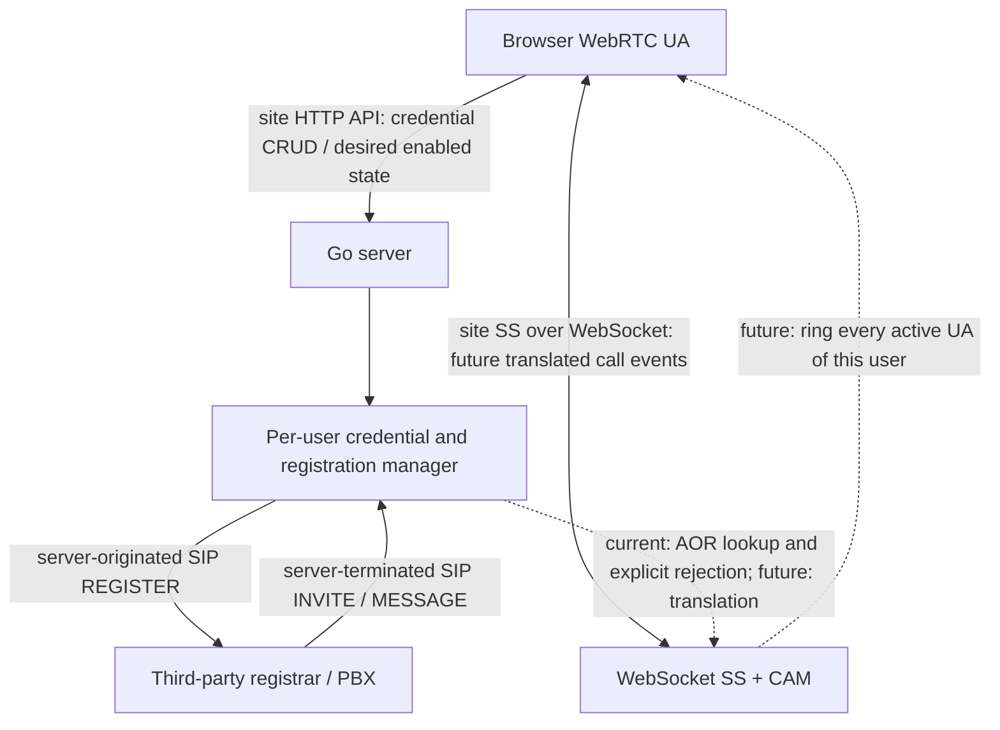
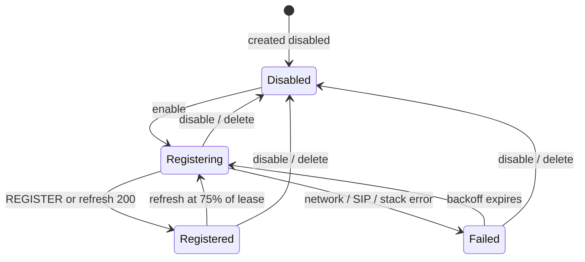

# User-level SIP subsystem

Status: **registration implemented; calls, ringing, MESSAGE delivery, and media
relay not implemented**. Last updated: 2026-11-22.

This document is the long-running design record for adding user-level SIP
signalling, calls, and media to the WebRTC system. It is intentionally separate
from [sip-bot.md](sip-bot.md): sip-bot is one ordinary UA/client attached to a
bot's WebRTC session, whereas this subsystem terminates SIP on behalf of every
site user.

## 1. Architectural boundary

The browser is never a SIP client of the third-party PBX/registrar. It does not
receive raw SIP over its WebSocket and does not send SIP over WebSocket to the
registrar. There are two distinct protocols and two distinct control planes:



- **Credential management** uses the site's authenticated HTTP API. A create,
  edit, delete, or enable change is a command in our own control protocol, not a
  SIP message relayed verbatim by the browser.
- **SIP registration and SIP signalling** are originated and terminated by the
  Go server. The server owns the SIP sockets, digest credentials, registration
  leases, and AOR routing table.
- **Future browser call signalling** uses the site's SS data model. The SIP
  adapter translates between that model and SIP; raw SIP is not exposed to the
  browser.
- **Future media** crosses a server-side RTP relay. It is not a browser-to-PBX
  media connection and not a transcoding bot.

The server, not localStorage or a React component, is the authority for both the
desired configuration (`enabled`) and the observed registration state. The
current store is process memory only. Database persistence of credentials is a
later decision, not an accidental property of this implementation.

## 2. Registration data model and API

Each credential belongs to one authenticated JWT subject (`Session.SubjectId()`)
and has a server-generated opaque ID. A username, session ID, channel-local
subscriber ID, or request-body user ID is not an owner key.

| Field          | Meaning                                                                             |
| -------------- | ----------------------------------------------------------------------------------- |
| `server`       | Registrar `host[:port]`; defaults to UDP/TCP/WS 5060, TLS 5061                      |
| `username`     | SIP user part; combined with the server host to form the AOR                        |
| `password`     | Write-only digest secret; retained on edit when the request leaves it empty         |
| `transport`    | `udp`, `tcp`, `tls`, or `ws`                                                        |
| `enabled`      | Desired state: an enabled account must keep trying to register                      |
| `registration` | Server-observed state, timestamps, consecutive failures, last error, and next retry |

The canonical routing AOR is `sip:<user>@<lowercase-host>`. SIP user parts stay
case-sensitive; host names do not. Registrar ports, URI transport parameters,
and To tags are not part of the identity key. An AOR must be unique across all
users because inbound signalling otherwise has no deterministic owner.

API (all paths require a valid JWT; none is on the authentication whitelist):

| Endpoint                           | Behavior                                                                          |
| ---------------------------------- | --------------------------------------------------------------------------------- |
| `GET /api/sip/credentials`         | List only the caller's credentials and live registration states                   |
| `POST /api/sip/credentials`        | Create; `enabled` defaults to true; 201 means saved, not registered               |
| `GET /api/sip/credentials/{id}`    | Read one caller-owned credential                                                  |
| `PUT /api/sip/credentials/{id}`    | Replace desired configuration; blank password and omitted `enabled` preserve them |
| `DELETE /api/sip/credentials/{id}` | Remove the route and credential, then de-REGISTER; 204                            |

Responses use `{"err":"..."}` for errors, have `Cache-Control: no-store`, and
never contain the password. Another user's credential ID is answered 404. The
frontend polls the list every three seconds while the settings view is active;
mutations invalidate the same React Query cache. No SIP credential or
registration status is stored in browser localStorage.

### State machine



`RegisteredAt` and `ExpiresAt` describe the last successful binding; a refresh
failure changes the state to `Failed` without erasing that history. `Attempts`
is the consecutive failure count and resets on success. Errors shown by the API
are operational diagnostics, not authentication secrets.

## 3. Runtime lifecycle

`pkg/sipregistration.Manager` holds the credential maps, AOR index, and worker
lifetimes. Each enabled credential has its own diago UA, ephemeral listener,
REGISTER transaction, and worker. This keeps contacts, credentials, transports,
and sockets independent; no credential binds a global 5060/5061 port.

A worker is the sole owner of its transaction. diago mutates the origin request,
CSeq, Via, Contact, Authorization, and expiry, so REGISTER, refresh, and
unregister are never concurrent.

- The first attempt and every refresh have a 5-second timeout.
- The requested lease is five minutes. Refresh occurs at 75% of the granted
  lease. The vendored diago patch exposes that lease and honors the successful
  response's `Contact;expires=` before its top-level `Expires` header.
- Every failure, including authentication rejection, schedules an automatic
  retry. Backoff starts at five seconds, doubles to a one-minute cap, and has
  ±20% jitter. Retry policy can later distinguish fatal configuration errors
  from transient failures without changing the desired/observed state model.
- Editing any enabled field, or disable → enable, replaces the worker. The old
  worker is cancelled, its in-flight attempt ends, and its de-REGISTER completes
  before the new worker starts. AOR-bucket locks reserve the old and target
  identities throughout this wait, including delete → recreate races.
- Disable and delete stop future attempts and remove reachability immediately.
  Once a REGISTER attempt may have reached the registrar, shutdown sends a
  best-effort de-REGISTER even if the success response was lost. It expires only
  this UA's Contact (`expires=0`), not `Contact: *`, so an ordinary SIP phone
  using the same account is not kicked off. It uses an independent five-second
  context because the worker context has already been cancelled. The socket
  remains alive until that request finishes, then the UA and transport close.
- `Close` is idempotent, removes all AOR routes, cancels every worker before
  waiting for any unregister, and then waits for workers. SIGINT/SIGTERM trigger
  HTTP graceful shutdown and the deferred manager close.

### Transport status

| Transport | Implementation      | Validation / caveat                                                                                                                                                           |
| --------- | ------------------- | ----------------------------------------------------------------------------------------------------------------------------------------------------------------------------- |
| UDP       | Supported           | Loopback digest REGISTER, refresh, inbound MESSAGE routing, and de-REGISTER integration-tested                                                                                |
| TCP       | Supported code path | Transport is explicitly selected on the Request-URI; wire-level registration test still needed                                                                                |
| TLS       | Supported code path | Outbound uses system roots and TLS ≥1.2. The ephemeral inbound listener certificate is not a stable/mTLS identity; deployment certificate configuration and wire tests remain |
| WS        | Supported code path | Server-side SIP over WS only; it has no relationship to the browser SS WebSocket. Registrar path/subprotocol interoperability and wire tests remain                           |

TLS secures signalling only. It does not imply SRTP on a future media leg.

## 4. Inbound routing now, and CAM fan-out next

The current runtime resolves inbound INVITE and MESSAGE by the To AOR through
the same manager-owned index used for credential ownership:

1. Extract and canonicalize `To.Address.User` and `To.Address.Host`.
2. Find the credential and its JWT user ID. Never trust a user ID supplied by
   the SIP peer.
3. If no mapping exists, emit a structured warning containing method, AOR,
   Request-URI, source, and transport-relevant metadata, then answer 404. Do not
   log passwords, Authorization headers, or MESSAGE bodies.
4. A known but disabled account receives 480. A matched enabled account
   currently receives 501 because call/message delivery is not implemented;
   this is an explicit rejection, not a success placeholder.

The configured mapping remains available while an account is disabled so the
server can distinguish an unknown AOR from a known offline one. Delete and
process close remove it. A future call dispatcher must additionally require a
currently valid registration and must handle a binding expiring between lookup
and delivery.

### Required ringing behavior

An inbound SIP INVITE must not be sent to one arbitrarily selected browser tab.
The correct route is:

```text
SIP AOR → JWT user ID → every active WebSocket/CAM entry with that user ID
        → translated SS incoming-call event to every active WebRTC UA
```

`websocket_ss` currently learns CAM keys as the complete
`(user ID, user session ID)` pair and can have several connections per pair.
The future dispatcher needs a hub-owned user index (or a hub-side query) that
fans out across both different session IDs and duplicate connections. It must
not read the CAM map concurrently from the SIP goroutine. Delivery should be
non-blocking with per-connection backpressure; a stuck browser must not stall a
SIP transaction or other sessions.

The call design must define a site-wide call ID, answer/decline/cancel races,
and dialog ownership. The expected policy is parallel ringing: the first valid
answer wins, the other WebRTC UAs are cancelled, and SIP CANCEL/final responses
are translated back. No active UA gives 480; unknown AOR gives 404. SS events
need an explicit external-SIP origin/credential identity rather than inventing
a channel subscriber that does not exist.

Outbound calls follow the inverse path: browser SS command → authenticated user
and selected owned credential → server SIP INVITE. The PBX is never asked to
trust a browser-supplied owner or From URI.

## 5. Media relay: preserve capabilities, translate transport only

This subsystem is **not** sip-bot's presumed-codec model and must not inherit
it. The relay discovers the actual offer/answer capabilities of both legs. It
does not assume a browser supports Opus, PCMU, VP8, stereo, or any other codec.

The intended media path is:

```text
Browser WebRTC UA
  ↔ ICE + DTLS-SRTP (mandatory WebRTC side)
Go RTP/RTCP relay
  ↔ RTP/RTCP, commonly plaintext RTP/AVP on the SIP side
SIP UA / PBX
```

The server may decrypt DTLS-SRTP on the WebRTC leg and emit plaintext RTP on a
SIP leg that negotiated it. If the SIP side negotiates a supported secure RTP
mode, the relay may instead encrypt for that leg. This is a security-transport
conversion, not audio/video transcoding.

The SDP gateway may rewrite only what its relay role requires: connection
addresses, ports, ICE/DTLS fingerprints and setup roles, SRTP attributes, and
other transport-specific fields. Codec payloads and their actual `rtpmap` /
`fmtp` capabilities pass through negotiation. If payload-type numbers must be
mapped between otherwise identical negotiated codec descriptions, rewriting
the RTP payload-type field is permitted; decoding and re-encoding the payload
is not. RTCP requires the corresponding transport/security treatment and
careful SSRC/sequence handling.

Rules:

- Do not inject a codec, fmtp feature, channel count, video capability, or
  telephone-event capability that the real endpoint did not offer.
- Do not transcode, mix, resample, or generate comfort media to hide an
  incompatible negotiation.
- If there is no mutually acceptable real codec, fail the negotiation (for
  example SIP 488) and report that failure through our SS call state.
- Keep offer/answer, re-INVITE, hold, DTMF, bundle, and early-media policies
  explicit when calls are designed; do not let diago defaults silently become
  product policy.

## 6. Security, memory, and known limitations

- Credentials and observed states disappear on process restart. Passwords are
  plaintext in process memory, as required to answer digest challenges; they
  are excluded from API responses and application log fields. Persistent
  storage will need an encryption/key-management and migration design.
- Creation is capped at eight credentials per user and 64 process-wide,
  including disabled entries. Visitor targets default to public IP space only:
  loopback, private, link-local, CGNAT, and mixed public/private DNS answers are
  rejected. The actual destination is pinned to the validated IP to prevent DNS
  rebinding while the AOR and TLS ServerName retain the configured domain.
  `--sip-allow-private-registrars` deliberately relaxes this for local
  development/trusted networks; ordinary authenticated users may use private
  PBXs without that flag.
- Visitor subjects are random per visitor login. A visitor who logs out and
  receives a new subject cannot recover the old subject's in-memory accounts;
  those accounts currently remain until process restart (bounded by the global
  quota). Repeated visitor logins can therefore occupy the global quota until
  restart; this is an accepted limitation of the current in-memory milestone,
  not a production-hardened quota/lifecycle design.
- Unsafe cookie-authenticated API writes require a same-origin or configured
  Origin, and POST/PUT additionally require `application/json`. Bearer clients
  do not rely on ambient cookies and are exempt from the Origin requirement.
  Responses remain no-store and passwords are never serialized.
- The requested registration expiry is fixed, not user-configurable. Very
  short leases, 423/Min-Expires, Retry-After, and fatal-vs-transient SIP status
  policies need more interoperability work.
- One process owns its in-memory AOR map and local SIP sockets. Multiple
  replicas need an explicit routing/ownership design; simply adding a shared
  credential database would not make inbound signalling or UDP listeners
  cluster-safe.
- Incoming calls and messages are rejected, not queued or shown as delivered.
  Phone-tab SIP dialing remains a placeholder.

## 7. Current implementation map and validation

- `pkg/sipregistration/types.go`: credential model, validation, canonical AOR.
- `pkg/sipregistration/manager.go`: user isolation, AOR index, workers, status,
  retry, refresh, replacement, deletion, and close.
- `pkg/sipregistration/diago_runtime.go`: real per-account SIP UA and transport.
- `pkg/sipregistration/inbound.go`: AOR resolution, structured unmatched logs,
  explicit current-stage SIP responses.
- `pkg/api/sipcredentials`: authenticated CRUD/status JSON adapter and password
  redaction.
- `cmd/server/main.go`: one process-level manager shared by all API requests.
- `web/site/src/hooks/useSipCredentials.ts`: browser control API and polling.
- `web/site/src/components/chat/SipRegistrationSettings.tsx`: real list, add,
  edit, delete, enable switch, and status/retry display. Detailed registration
  diagnostics go to `console.error` with credential/AOR context, not into the
  visible credential card.
- `third_party/diago/register_transaction.go`: transaction cleanup, fresh Via,
  granted-expiry accessor, and own-Contact/transport-aware expiry parsing.

Focused tests cover domain lifecycle, parallel cancellation on close, retries,
user isolation, HTTP redaction and Origin checks, real UDP digest
registration/refresh/unregister, lost success responses, blackhole transaction
timeouts, and matched/unmatched inbound MESSAGE routing. The diago nested-module
tests cover granted expiry parsing and Contact-specific unregister. See session note `.ai/memory/sessions/60.md` for exact commands
and the latest validation results.

## 8. Decision / progress log

### 2026-11-22 — registration milestone

- Chose a new system service rather than embedding user registration in
  sip-bot. Reused diago/sipgo protocol mechanics, not the bot's peer-session
  lifecycle or presumed browser codec lists.
- Chose independent per-credential UAs and ephemeral sockets to avoid transport
  and Contact coupling. Kept one manager-owned AOR → user/credential index as
  the routing authority.
- Separated desired configuration from observed registration state. CRUD success
  is asynchronous registration progress, never a claim that the PBX accepted
  the account.
- Made replacement teardown precede replacement REGISTER and reserved AORs
  across the entire teardown window; switched to Contact-specific unregister so
  other devices sharing the SIP account keep their bindings.
- Patched diago's expiry handling to select our own Contact among multiple
  bindings, parse parameter names case-insensitively, and retain a safe lease
  after malformed responses instead of silently refreshing on the wrong one.
- Recorded the browser/PBX protocol boundary, future all-UA CAM fan-out, and
  transport-only/no-transcoding media principles before call implementation.
