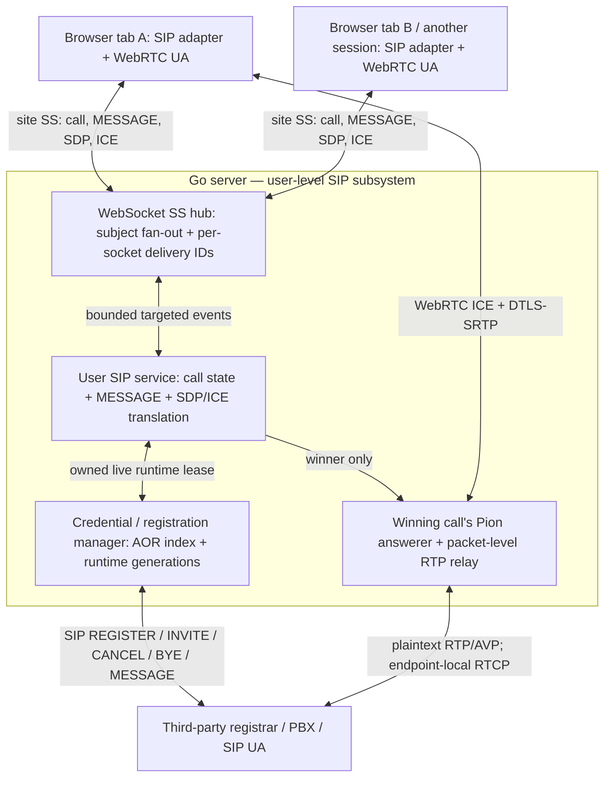
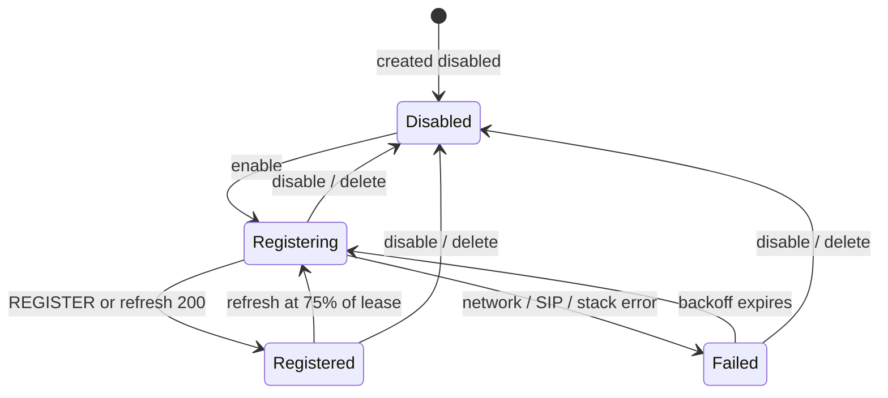

# User-level SIP subsystem

Status: **registration, outbound and inbound voice/video calls, parallel browser
ringing, and pager-mode SIP MESSAGE implemented**. Last updated: 2026-11-24.
The SIP media leg is currently plaintext RTP/AVP; the exclusions and validation
blind spots are listed explicitly below rather than implied to be complete.

This document is the long-running design record for user-level SIP signalling,
calls, messages, and media in the WebRTC system. It is intentionally separate
from [sip-bot.md](sip-bot.md): sip-bot is one ordinary UA/client attached to a
bot's WebRTC session, whereas this subsystem terminates SIP on behalf of every
site user. No sip-bot registration, yellow-page, or bot-session lifecycle is
used here.

## 1. Architectural boundary

The browser is never a SIP client of the third-party PBX/registrar. It does not
receive raw SIP over its WebSocket and does not send SIP to the registrar. HTTP
credential management, site SS service events, SIP signalling, and media are
separate planes:



- **Credential management** uses the authenticated HTTP API. Create, edit,
  delete, enable, and disable are commands in the site's control protocol, not
  raw SIP relayed by the browser.
- **SIP registration and signalling** are originated and terminated by the Go
  server. It owns SIP sockets, digest credentials, registration leases, AOR
  routing, dialogs, and the runtime generation used by each call.
- **Browser call and MESSAGE signalling** uses first-class SIP service payloads
  in the site's SS envelopes (`c2SEv` toward the service, `s2CEv` toward the
  browser). These payloads carry external SIP identities, call/message state,
  SDP, and ICE, but never raw SIP requests. They do not invent a channel
  subscriber and do not use the chat DataChannel.
- **Media** uses one dedicated Pion answerer per outbound call or winning
  inbound browser delivery. The RTP relay preserves encoded payloads and
  translates transport/security and payload types; it is not a transcoding bot.
- **Parallel ringing is user-wide.** The hub, not the SIP goroutine, owns the
  connection set. A SIP AOR resolves to a JWT subject, then fans out across all
  session IDs and duplicate tabs. Each socket gets an opaque delivery ID so
  duplicate tabs sharing one session remain independently answerable.

The server, not localStorage or a React component, is authoritative for desired
configuration (`enabled`), observed registration state, credential ownership,
and call control. The credential store, active calls, and pending MESSAGE
transactions are process memory only. Browser call/message history is also
in-page state, not a durable message store.

## 2. Registration data model and API

Each credential belongs to one authenticated JWT subject (`Session.SubjectId()`)
and has a server-generated opaque ID. A username, session ID, channel-local
subscriber ID, or request-body user ID is not an owner key.

| Field          | Meaning                                                                             |
| -------------- | ----------------------------------------------------------------------------------- |
| `server`       | Registrar `host[:port]`; defaults to UDP/TCP/WS 5060, TLS 5061                      |
| `username`     | SIP user part; combined with the server host to form the AOR                        |
| `password`     | Write-only digest secret; retained on edit when the request leaves it empty         |
| `transport`    | `udp`, `tcp`, `tls`, or `ws`                                                        |
| `enabled`      | Desired state: an enabled account must keep trying to register                      |
| `registration` | Server-observed state, timestamps, consecutive failures, last error, and next retry |

The canonical routing AOR is `sip:<user>@<lowercase-host>`. SIP user parts stay
case-sensitive; host names do not. Registrar ports, URI transport parameters,
and To tags are not part of the identity key. An AOR must be unique across all
users because inbound signalling otherwise has no deterministic owner.

API (all paths require a valid JWT; none is on the authentication whitelist):

| Endpoint                           | Behavior                                                                          |
| ---------------------------------- | --------------------------------------------------------------------------------- |
| `GET /api/sip/credentials`         | List only the caller's credentials and live registration states                   |
| `POST /api/sip/credentials`        | Create; `enabled` defaults to true; 201 means saved, not registered               |
| `GET /api/sip/credentials/{id}`    | Read one caller-owned credential                                                  |
| `PUT /api/sip/credentials/{id}`    | Replace desired configuration; blank password and omitted `enabled` preserve them |
| `DELETE /api/sip/credentials/{id}` | Remove the route and credential, then de-REGISTER; 204                            |

Responses use `{"err":"..."}` for errors, have `Cache-Control: no-store`, and
never contain the password. Another user's credential ID is answered 404. The
frontend polls the list every three seconds while the settings or phone view is
active; mutations invalidate the same React Query cache. No SIP credential or
registration status is stored in browser localStorage.

### State machine



`RegisteredAt` and `ExpiresAt` describe the last successful binding; a refresh
failure changes the state to `Failed` without erasing that history. `Attempts`
is the consecutive failure count and resets on success. Errors shown by the API
are operational diagnostics, not authentication secrets.

An enabled credential with an unexpired `ExpiresAt` remains usable during a
refresh or a failed refresh until that old binding actually expires. The dialer
and MESSAGE composer therefore select from **enabled + currently unexpired**
accounts, not merely the transient string `registered`; the server rechecks the
same lease and ownership when executing the operation. An initial
`Registering` account with no prior binding is not eligible.

## 3. Runtime lifecycle

`pkg/sipregistration.Manager` holds the credential maps, AOR index, current
runtime pointer, and worker lifetimes. Each enabled credential has its own diago
UA, ephemeral listener, REGISTER transaction, and worker. Contacts, credentials,
transports, sockets, and dialogs remain independent; no credential binds a
global 5060/5061 port.

A worker is the sole owner of its REGISTER transaction. diago mutates the origin
request, CSeq, Via, Contact, Authorization, and expiry, so REGISTER, refresh,
and unregister are never concurrent. Independent calls and out-of-dialog
MESSAGEs use the same retained diago UA but do not mutate that REGISTER
transaction.

- The first attempt and every refresh have a 5-second timeout.
- The requested lease is five minutes. Refresh occurs at 75% of the granted
  lease. The vendored diago patch exposes that lease and honors the successful
  response's `Contact;expires=` before its top-level `Expires` header.
- Every failure, including authentication rejection, schedules an automatic
  retry. Backoff starts at five seconds, doubles to a one-minute cap, and has
  ±20% jitter.
- Editing any enabled field, or disable → enable, replaces the worker. The old
  worker is cancelled, its calls are terminated, its in-flight attempt ends,
  and its de-REGISTER completes before the new worker starts. AOR-bucket locks
  reserve the old and target identities throughout this wait.
- Disable and delete stop future attempts, cancel that exact runtime's calls,
  and remove reachability immediately. The runtime's operation context is
  cancelled before unregister, but its listener remains alive until the
  Contact-specific de-REGISTER finishes because diago shares the UDP socket.
- Once a REGISTER attempt may have reached the registrar, shutdown sends a
  best-effort de-REGISTER even if the success response was lost. It expires only
  this UA's Contact (`expires=0`), not `Contact: *`, so an ordinary SIP phone
  using the same account is not kicked off.
- `Close` is idempotent. It stops the call/MESSAGE service first, removes all
  AOR routes, cancels every worker before waiting for any unregister, and then
  waits for workers. SIGINT/SIGTERM trigger HTTP graceful shutdown and the
  deferred manager close.

Outbound calls and MESSAGEs acquire a generation-checked runtime lease. The
request leaves through the registrar destination validated and pinned when the
runtime was created; it does not re-resolve either the registrar or the target
host. The account's owned AOR, not a browser-supplied From URI, is stamped on
INVITE and MESSAGE, with digest authentication as required.

Inbound callbacks close over the exact receiving runtime. Delivery requires all
of these to agree: current runtime pointer, credential ID/owner, canonical To
AOR, enabled state, and a currently valid registration binding. A request that
arrives on account A's socket with account B's To AOR cannot be delivered to B.

### Transport status

| Transport | Implementation      | Validation / caveat                                                                                                                                             |
| --------- | ------------------- | --------------------------------------------------------------------------------------------------------------------------------------------------------------- |
| UDP       | Supported           | Digest REGISTER/refresh/unregister, outbound INVITE/ACK/BYE and MESSAGE, inbound INVITE/180/CANCEL/200/487 and MESSAGE have loopback wire tests                 |
| TCP       | Supported code path | Transport is explicitly selected on the Request-URI; registration, call, MESSAGE, and media wire tests are still needed                                         |
| TLS       | Supported code path | Outbound uses system roots and TLS ≥1.2. The ephemeral inbound listener certificate is not a stable/mTLS identity; deployment certificate and wire tests remain |
| WS        | Supported code path | Server-side SIP over WS only; unrelated to browser SS. Registrar path/subprotocol interoperability and wire tests remain                                        |

TLS secures SIP signalling only. It does not imply SRTP on the media leg.

## 4. Calls, ringing, and MESSAGE

### SS service contract

`WellKnownSvcIdSIP` identifies the server-side service. `SIPCallEvent` carries:

- browser command `action`: `dial`, `accept`, `decline`, `cancel`, `hangup`, or
  `ice`;
- `callId`, owned `credentialId`, `target`, `kind` (`voice` / `video`);
- server `direction`, `state`, `localUri`, `remoteUri`, and concise `reason`;
- browser-offer / server-answer `sessionDesc` and trickle `rtcICECandidate`.

Outbound call states are `dialing`, `ringing`, `answering`, `accepted`, then a
terminal `ended`, `cancelled`, `rejected`, or `failed`. `answering` carries the
WebRTC answer while SIP ACK/answer confirmation completes; only `accepted`
starts browser capture and the media relay.

`SIPMessageEvent` carries a client UUID `messageId`, credential/target/text for
`send`, and server `sent` / `failed` / `received` state with identities,
timestamp, and failure reason. WebSocket write success is not presented as SIP
delivery success; only the server's post-transaction event marks `sent`.

Client frames have their complete From address replaced from the authenticated
session, including clearing any claimed service ID. Client-supplied `s2CEv` is
discarded. Consequently an ordinary c2c relay frame cannot forge a trusted SIP
service call, message, SDP, or ICE event.

The hub uses bounded queues and nonblocking sends. A full socket queue drops
that socket without stalling other sessions. Removed sockets cannot be
re-learned by an already queued stale frame. The service preserves FIFO control
order per browser delivery, while INVITE, Answer, MESSAGE transactions, and
media waits run asynchronously so a long SIP operation does not block later
ICE or hangup commands.

### Outbound voice and audio/video calls

1. The dialog requires target, media kind, and a selected caller SIP identity.
   The browser creates an actual audio (and optional video) SDP offer before any
   SIP INVITE. No camera/microphone capture is required merely to create that
   offer.
2. The service derives the owner from the authenticated socket, rechecks the
   selected credential and lease, validates the target, parses the browser's
   real capabilities, and creates the SIP media offer. A bare user is completed
   with the account's registrar host; a full SIP URI is allowed only with the
   account's matching scheme/transport. URI headers, passwords, controls, and
   malformed targets are rejected.
3. The server sends INVITE through the pinned registrar with the selected AOR
   and digest credential. SIP 180/183 produces browser `ringing`; 183 does not
   enable early media in this milestone.
4. On final 2xx, the actual browser offer and SIP answer are intersected. The
   server creates the Pion answer, sends it in `answering`, ACKs SIP, then emits
   `accepted` and starts the relay. No common audio, invalid media addresses,
   or WebRTC setup failure produces terminal failure; a received final 2xx is
   still ACKed and then BYEd when it cannot be used.
5. Browser `cancel` aborts a pending INVITE. `hangup` after answer uses BYE.
   Remote dialog termination, browser disconnect, credential replacement, and
   process close converge on exactly-once cleanup. Cancellation during offer
   creation cannot produce a later dial; an already in-flight dial is followed
   by its cancel on the ordered write path.

### Inbound parallel ringing

1. Validate the exact runtime/AOR/lease, an early plaintext SDP offer, active
   audio, and allowed remote media addresses. Late-offer INVITE, unsupported
   profiles, or unusable audio receive 488; visitor media-policy violations
   receive 403.
2. Create a site-wide call ID and fan out one incoming `ringing` event to every
   active socket of the resolved user. No queued delivery gives SIP 480.
   Otherwise send SIP 180 and keep diago's serve handler blocked for the dialog
   lifetime.
3. Each answering browser sends its own real SDP offer. The first **valid**
   accept wins atomically; all losing sockets receive targeted cancellation.
   The winner's browser capabilities and the SIP offer are intersected before
   either side is answered.
4. The server pins the SIP answer and Pion answer from that intersection, sends
   browser `answering` + SDP, and calls diago `Answer`. After 200/ACK succeeds,
   it emits `accepted` and starts the relay. A browser hangup crossing the
   pre-ACK window waits for answer completion or dialog termination before
   BYE. If 200 was sent but ACK later fails, diago's `Established` state selects
   BYE—not a second 480 response.
5. Declining one tab cancels only that delivery. When every remaining delivery
   declines, SIP receives 603. An invalid accept rejects only that leg; if it
   was the last usable leg, SIP receives 488. Caller CANCEL cancels all legs;
   sipgo answers matched CANCEL with 200 and terminates INVITE with 487.
6. The default ring deadline is 60 seconds. Winner disconnect ends the SIP
   dialog; losing all ringing deliveries produces 480. A late answer from a
   stale, declined, disconnected, or losing delivery is ignored.

### Pager-mode SIP MESSAGE

- Outbound text must be nonempty valid UTF-8 and at most 16 KiB. It is sent as
  `text/plain; charset=utf-8` through the selected account's registrar, with one
  401/407 digest retry and a 10-second bound. Final non-2xx and timeout produce
  a correlated `failed` event; 2xx produces `sent`.
- Inbound `text/plain` is decoded as UTF-8 and fanned out to every active socket
  of the AOR owner. At least one accepted browser queue produces SIP 200; no
  reachable delivery produces 480. A body over 16 KiB produces 413; unsupported
  or invalid content produces 415 with `Accept: text/plain`.
- SIP 200 means the server accepted the message into at least one browser queue,
  not that a person read it. Messages are not persisted, synchronized to new
  tabs, or queued for offline delivery.
- CPIM, attachments, in-dialog MESSAGE, delivery/read receipts, and rich content
  are not implemented. These are explicit exclusions, not silently rendered as
  plain text.

## 5. Media relay: preserve capabilities, translate transport only

This subsystem does **not** inherit sip-bot's presumed-codec model. The browser
offer is required in both directions: outbound before INVITE, inbound from the
winning tab before SIP 200. The relay discovers the actual offer/answer
capabilities of both legs.

The implemented media path is:

```text
Browser WebRTC UA
  ↔ ICE + DTLS-SRTP (mandatory WebRTC side)
Dedicated Pion answerer + Go RTP relay
  ↔ plaintext RTP/AVP + endpoint-local RTCP (current SIP side)
SIP UA / PBX
```

The SDP gateway rewrites transport fields and opens its own SIP RTP/RTCP
sockets. Codec payloads and their actual `rtpmap` / `fmtp` descriptions are
matched, not invented. Dynamic payload types may differ between legs and are
translated in the RTP header. H.264 matching includes packetization mode and a
normalized profile; Opus matching includes channels and stereo/FEC parameters.
Generic shared fmtp conflicts also prevent a match.

Rules and implemented behavior:

- One browser-preferred audio pair and at most one video pair are selected for
  the relay. Audio is mandatory; video is optional. A SIP video offer with no
  usable match receives a port-0 video m-line rather than being silently omitted.
- To keep a UDP INVITE below sipgo's MTU, the initial outbound offer is bounded
  to at most four actual primary audio and two actual primary video capabilities
  in browser preference order after helper payloads are removed. This retains
  the usual Opus/G722/PCMU/PCMA audio fallbacks and Chrome's VP8/H264 path;
  answer-time relay selection still narrows to one pair per media kind.
- No codec, fmtp feature, channel count, telephone-event, comfort-noise, RTX,
  RED, or FEC capability is injected. Those helper payloads are not relayed.
- No decode, transcode, mix, resample, comfort-media generation, or free-running
  packet pacer is used. RTP payload bytes, media timestamps, and marker bits are
  preserved. SSRCs and sequence numbers are leg-local.
- Audio and video share the initial SIP RTP socket. A distinct negotiated SIP
  video destination gets a dedicated UDP writer whose lifetime belongs to the
  relay. Selected audio/video PTs must be distinct on the shared socket.
- Offer/answer direction is honored: sendonly/recvonly map correctly in answers,
  inactive stays inactive, and the relay drops packets prohibited by the
  negotiated direction. A disallowed send direction does not open a video
  writer socket.
- Pion and diago each handle their own RTCP. RTCP is **not forwarded or
  translated between legs**; SSRC/sequence mappings are therefore local to each
  leg rather than an end-to-end RTCP gateway.
- Browser-to-SIP header extensions, CSRCs, and padding are not preserved by the
  payload writer. The relay is deliberately a packet-payload bridge, not a
  complete RTP semantic translator.
- No common real audio codec fails negotiation (inbound SIP 488 or outbound
  terminal failure with ACK/BYE); it never triggers transcoding.

Current exclusions: SIP-side SRTP/SDES/DTLS-SRTP, late-offer inbound calls,
early-media forwarding, DTMF, re-INVITE/hold updates, multiple audio/video
m-lines, and non-RTP media profiles. Tagged re-INVITE is explicitly answered
488 so diago cannot silently apply an unsupported media update. The configured
WebRTC STUN/TURN URLs are used by Pion, but SIP media currently advertises the
runtime's route-selected local address; a deployment behind NAT still needs a
reachable media-address/NAT design. STUN/TURN, NAT, packet loss/reordering, and
real-browser-plus-live-PBX media interoperability are not established by unit
tests alone.

## 6. Security, memory, and known limitations

- Credentials and observed states disappear on process restart. Passwords are
  plaintext in process memory, as required to answer digest challenges; they
  are excluded from API responses and application log fields. MESSAGE bodies,
  Authorization headers, and SDP credentials/fingerprints are not logged.
- Creation is capped at eight credentials per user and 64 process-wide,
  including disabled entries. Registrar and negotiated media targets may use
  public, private, loopback, or other locally reachable addresses for every
  subject; no visitor-only public-network egress policy is applied.
- Visitor subjects are random per visitor login. A visitor who logs out and
  receives a new subject cannot recover the old subject's in-memory accounts;
  those accounts currently remain until process restart (bounded by the global
  quota). Repeated visitor logins can therefore occupy the global quota until
  restart; this remains an accepted in-memory limitation.
- Unsafe cookie-authenticated API writes require a same-origin or configured
  Origin, and POST/PUT additionally require `application/json`. Bearer clients
  do not rely on ambient cookies and are exempt from the Origin requirement.
- Browser event intake and SIP operations are bounded, but this is not a full
  anti-abuse system. Per-user inbound call rate limits, broader media quotas,
  and durable offline lifecycle management remain hardening work. Inbound SIP
  caller/sender identity is unauthenticated display data.
- One process owns its in-memory AOR map, active calls, and local SIP sockets.
  Multiple replicas need an explicit routing/ownership design; simply adding a
  shared credential database would not make inbound signalling, dialogs, or UDP
  listeners cluster-safe.
- Browser call/message history is per page incarnation. Reconnect ends active
  external SIP calls; the server also terminates the affected delivery. There is
  no call transfer to a replacement tab and no MESSAGE replay after reconnect.
- The requested registration expiry is fixed, not user-configurable. Very short
  leases, 423/Min-Expires, Retry-After, and fatal-vs-transient SIP status policy
  need more interoperability work.

## 7. Current implementation map and validation

Backend:

- `pkg/models/ss/ss.go`: SIP service ID, call/MESSAGE wire types, and SDP/ICE
  payloads in the existing SS envelopes.
- `pkg/api/websocket_ss/websocket_ss.go`: authenticated SIP interception,
  client-spoof stripping, per-socket delivery IDs, hub-owned subject fan-out,
  targeted delivery, stale-connection rejection, and backpressure.
- `pkg/sipregistration/types.go`, `manager.go`: credential model, registration
  workers, current-runtime leases, service lifecycle, and exact-generation
  teardown.
- `pkg/sipregistration/diago_runtime.go`: per-runtime callbacks and transports;
  `runtime_operations.go`: owned digest INVITE/MESSAGE, pinned registrar,
  target/text validation, operation cancellation, and media ownership.
- `pkg/sipregistration/service.go`: ordered browser commands, outbound and
  inbound call state machines, parallel ringing, answer/decline/cancel/BYE,
  MESSAGE results/delivery, media-egress checks, and cleanup.
- `pkg/sipregistration/sdp.go`: browser/SIP profile parsing, actual capability
  matching, dynamic PT/fmtp handling, direction mapping, and SDP generation.
- `pkg/sipregistration/media.go`: diago media sessions, dedicated Pion
  answerers, ICE, bidirectional audio/video RTP relay, and demuxed video output.
- `pkg/sipregistration/inbound.go`: exact runtime + AOR + lease routing and SIP
  status mapping.
- `cmd/server/main.go`: one manager/service/hub wiring shared by all users.
- `third_party/diago`: Contact-specific registration mechanics plus local
  case-insensitive codec matching and cancellation-safe final-2xx ACK/BYE
  cleanup; `PATCHES.md` records the vendored changes.

Browser:

- `web/site/src/api/ss/types.ts`: TypeScript mirror of the SIP service contract.
- `web/site/src/api/ss/sip.ts`: call/message reducers and history, ordered SS
  commands, one RTCPeerConnection per call, offer/answer/ICE queues, media
  capture/playback, and best-effort server abort on local failures.
- `web/site/src/components/chat/PhonePanel.tsx`: voice/video dial dialog,
  unexpired caller-identity selection, SIP MESSAGE composer/history/reply.
- `web/site/src/components/chat/ExternalSIPCallOverlay.tsx`: incoming answer /
  decline, outbound/active status, hangup, and local/remote video.
- `web/site/src/components/chat/sipForm.ts`: caller eligibility and selection.

The main test files are `pkg/sipregistration/{service,runtime_operations,sdp,media,inbound_wire}_test.go`,
`pkg/api/websocket_ss/sip_test.go`, `pkg/models/ss/sip_test.go`, and
`web/site/src/api/ss/sip.test.ts` plus `components/chat/sipForm.test.ts`.
They cover registration and ownership, real UDP digest INVITE/MESSAGE,
provisional/final responses, ACK/BYE and CANCEL behavior, parallel answer races,
per-tab/all-tab decline, timeout/disconnect/replacement, SDP capabilities and
directions, Pion-to-Pion negotiation, bidirectional arbitrary-payload RTP,
MESSAGE status and spoof resistance, browser offer/ICE ordering, local failure
notification, and reconnect configuration.

Validation commands and live-browser results for this milestone are recorded in
the 2026-11-24 progress entry below and in `.ai/memory/sessions/61.md`; the
document does not infer wire or browser coverage from unit-test names alone.

## 8. Decision / progress log

### 2026-11-22 — registration milestone

- Chose a new system service rather than embedding user registration in
  sip-bot. Reused diago/sipgo protocol mechanics, not the bot's peer-session
  lifecycle or presumed browser codec lists.
- Chose independent per-credential UAs and ephemeral sockets to avoid transport
  and Contact coupling. Kept one manager-owned AOR → user/credential index as
  the routing authority.
- Separated desired configuration from observed registration state. CRUD success
  is asynchronous registration progress, never a claim that the PBX accepted
  the account.
- Made replacement teardown precede replacement REGISTER and reserved AORs
  across the entire teardown window; switched to Contact-specific unregister so
  other devices sharing the SIP account keep their bindings.
- Patched diago's expiry handling to select our own Contact among multiple
  bindings, parse parameter names case-insensitively, and retain a safe lease
  after malformed responses instead of silently refreshing on the wrong one.
- Recorded the browser/PBX protocol boundary, all-UA fan-out, and
  transport-only/no-transcoding media principles before call implementation.

### 2026-11-24 — calls, ringing, MESSAGE, and media milestone

- Added first-class external-SIP SS service events rather than forcing calls or
  messages through a synthetic channel subscriber or a bot DataChannel. The
  existing hub now provides bounded, user-wide, per-socket fan-out.
- Required actual browser SDP in both call directions. Selected one real audio
  and optional video codec pair, with explicit dynamic PT/fmtp/direction
  handling and no transcoding. Reused sip-bot's protocol/RTP lessons, but not
  its registration, yellow pages, presumed codecs, or bot lifecycle.
- Chose plaintext RTP/AVP as the explicit initial SIP media scope. WebRTC still
  uses ICE + DTLS-SRTP. Early media, DTMF, re-INVITE/hold, CPIM, in-dialog
  MESSAGE, and SIP-side SRTP remain deliberately unimplemented.
- Made the first valid inbound answer win across sessions and duplicate tabs;
  declines and disconnects are delivery-local until no usable tab remains.
  Account edit/disable/delete and process close terminate the exact old runtime
  generation's calls.
- Kept browser control FIFO while moving SIP/network waits off the control loop.
  Browser negotiation failures notify the server, and pre-offer cancellation
  cannot resurrect an outgoing call.
- Review corrections added stale-socket removal invariants, client service-event
  spoof stripping, final-2xx cancellation-safe ACK/BYE, pre-200 versus
  Established/Confirmed teardown, media-session cleanup, case-insensitive codec
  names, and negotiated media-direction enforcement.
- A real UDP CANCEL regression disproved the suspected matched-CANCEL bug:
  sipgo already sends CANCEL 200 and INVITE 487 before diago's unmatched-only
  handler. No duplicate application-level CANCEL response was added.
- Live Chrome exposed an initial video-call failure when the full browser
  capability list made sipgo reject the UDP INVITE as over MTU. The bounded
  actual-capability offer described above fixed it and gained a large-SDP
  regression test.

Final automated validation:

- `go test -race ./pkg/sipregistration ./pkg/api/websocket_ss ./pkg/models/ss -count=1` — passed.
- `go test ./... -count=1` — passed on the final rerun, including e2e and sip-bot.
- Nested diago final-2xx bad-media/cancellation tests passed with `-race
-count=20`; focused media codec tests passed. The complete nested diago suite
  was not run.
- `npm test -- --silent` — 13 files / 133 tests passed; TypeScript, ESLint, and
  `npm run build` passed. Build emitted only the existing static-export
  headers/rewrites warnings. `git --no-pager diff --check` passed.

Live validation used isolated Chrome tabs and a temporary loopback UDP PBX:

- Two registered caller identities appeared in the dialog. Selecting `1002`
  produced PBX `INVITE from=1002`, ACK, In call, and browser BYE.
- Audio+video negotiation reached stable, connected ICE/DTLS with PCMU + VP8
  and live audio/video receivers; browser stats observed actual inbound audio
  RTP. Mic/camera permission stayed at `prompt`, and the PBX did not generate
  valid video frames, so local capture and decoded two-way video are not claimed.
- Outbound MESSAGE showed Sent; inbound MESSAGE returned SIP 200 and appeared
  as Received. Two tabs sharing one visitor session rang together; accepting one
  produced PBX answered and removed the other's popup.
- Automated RTP tests also use local Pion peers. NAT, loss/reordering, external
  PBX interoperability, TCP/TLS/WS, SRTP, and full two-way browser video remain
  validation blind spots. The temporary `scratch_sip_e2e/` directory remains
  for inspection because its deletion was not permitted; it is not product code.
